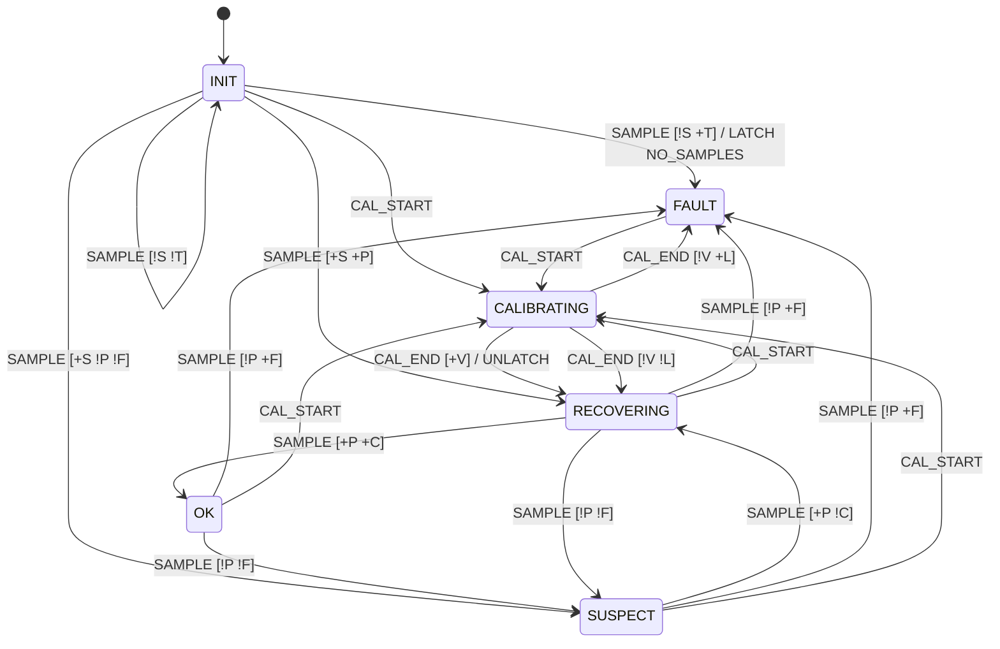

# stick

`hmi::stick::StickPipeline`: the three pots' raw millivolts in, the keypad key and the motion
command (XYTwist) out. Safety-relevant (CS-SAF-01): it turns the joystick into the motion
command. Extracted, refactor only, from `adc_task_fn` in `main/main.cpp` (dev_refactor
7ea7592); the ADC task still owns it and still does the reads, the twist filter and the
timing.

## Requirements (as-is, characterised 2026-10-06)

These state what the code does today, pinned by golden vectors taken from the code before the
extraction (`test/golden_stick.inc`, frozen). They are not a reviewed specification.

| ID | Requirement | Tests |
| --- | --- | --- |
| REQ-STK-01 | Raw mV maps to a position in [-1, 1] per axis through `espp::Joystick`: X/Y with a circular dead zone and a range dead zone, the vertical pot inverted (+y up), twist on its own range mapper with its own mV dead bands. | STK-001, STK-002 |
| REQ-STK-02 | The mounted stick is swapped first, then mirrored per axis; twist is untouched. | STK-002, STK-034 |
| REQ-STK-03 | The key is a Schmitt trigger on the larger axis, with thresholds set by the sensitivity (1..10, clamped); a calibration run releases it; the remote key overrides it; a new key is latched as a flick. | STK-019, STK-022, STK-023, STK-030..032, STK-036 |
| REQ-STK-04 | RETIRED 2026-10-08, superseded by REQ-STK-10. The command is the mounted position times a scale: 0 while calibrating or while the gate (`stick_drives`) is closed, else drive speed / 10 (1..10, clamped). The 0 is a multiply. | – |
| REQ-STK-05 | A cycle with any of the three reads missing publishes nothing and calls nothing else. | STK-005, STK-015 |
| REQ-STK-06 | A cycle calls its `Io` in the order of the original code. | STK-003, STK-004 |
| REQ-STK-08 | `pipeline_config` gives the HMI's mounting: center dead zone radius 0.10, range dead zone 0.05, twist dead bands 60 mV (center) and 40 mV (range), with the caller's calibration and key codes (the values main passed before they moved here). | STK-037 |
| REQ-STK-09 | A stick-button release within SELECT_MAX_US (500 ms) of its press selects; every press more than COUNT_DEBOUNCE_US (30 ms) after the last counted press counts (only the counter is debounced). | STK-050..052 |

## The output permit (hazard-c1-spec.md §3, approved 2026-10-08)

`stick/output_permit.hpp`: `OutputPermit`, the one gate between the stick and XYTwist for the
hazard fixes C1, C3, C4 and C2. The pipeline asks its Io `output_permit(mounted)` on every
valid cycle, where it asked `stick_drives()` before; a held stick sends `HELD_COMMAND`, a
literal (+0.0, +0.0, +0.0). Its hooks (`stick/permit_types.hpp`, `stick/permit_hooks.hpp`):
the POST gate (NOT_RUN until C3's runner), stick health (NOT_MONITORED, which passes, until
C2), the hold reason it publishes, and C4's motion guard (an input of the cycle, OK until C4).
Main's `AdcStickIo` owns the permit and gives it the ADC task's `uint32` ms clock.

| ID | Requirement | Tests |
| --- | --- | --- |
| REQ-STK-10 | When the output permit is withheld, the command is exactly (+0.0, +0.0, +0.0), whatever the position (NaN and negatives included) | STK-002, STK-060 |
| REQ-STK-11 | The output permit is the gate AND the motion guard's verdict OK AND no calibration AND a measured calibration AND POST PASS AND stick health allowing output AND the neutral latch | STK-064, STK-066, STK-067 |
| REQ-STK-12 | The neutral latch sets after >= `kNeutralHold` (300 ms) of valid cycles all at x = y = twist = 0.0; a non-neutral, NaN or invalid cycle restarts the wait; any other permit condition failing clears it (and the wait); once set it stays while they hold | STK-061..065 |
| REQ-STK-13 | The hold reason is the first failing condition in the order GATE_SHUT, MOTION_GUARD, CALIBRATING, NOT_CALIBRATED, POST_NOT_PASSED, STICK_FAULT, STICK_CHECK, CENTRE_FIRST, else NONE | STK-004, STK-066 |
| REQ-STK-14 | POST gate NOT_RUN, PENDING and FAIL withhold output; PASS allows. Stick health FAULT (reason STICK_FAULT) and CHECK (reason STICK_CHECK) withhold; NOT_MONITORED and OK allow. The motion guard's verdict allows only OK; until C4 it is always OK | STK-067 |
| REQ-STK-15 | While the POST gate is not PASS, XYTwist carries the stick button released; otherwise it carries the button as it reads, held or not (hazard-c3-spec.md §2.11, decisions D12 a, C3 Q11) | STK-068 |

## Bench stick injection (`stick/bench_inject.hpp`, hazard-fixes.md §3 B1)

Bench only: the firmware uses it only behind `CONFIG_HMI_BENCH_STICK_INJECT` (which depends on
`CONFIG_HMI_REMOTE_UI`), selected at compile time (`StickSlot`), so a release build compiles none of it. The
remote UI's `STICK` verb parses a `StickInjectMsg` and writes it to an `fw_core` mailbox; the ADC
task drains it and swaps its raw sample for the injected one (`StickInjector::sample`, C2's
`RawSample`) before the monitor and `StickPipeline::cycle`
(`components/remote_ui/include/stick_inject.hpp`). Everything after the reads is the real code.

| ID | Requirement | Tests |
| --- | --- | --- |
| REQ-STK-07 | RETIRED 2026-10-11, superseded by REQ-STK-26. `STICK <h_mv> <v_mv> <twist_mv> <fail_mask> <seq>` is accepted only as five unsigned decimals, mV 0..3300, mask 0..7, seq 0..2^32-1; anything else is rejected. An injection replaces all three raw reads, failed real reads included, until 300 ms after its last message (a refresh restarts the 300 ms; a clock earlier than the message ends it); then the real reads pass unchanged. Each `fail_mask` bit (1 horizontal, 2 vertical, 4 twist) makes that read fail. Injected reads go through the real pipeline, gate and H9 behaviour included. | – |
| REQ-STK-26 | `STICK <h> <v> <tw> <mask> <seq>`: mV 0..3300, mask 0..255, seq 0..2^32−1, else rejected. Mask bits: 0-2 the read fails (h, v, twist), 3-5 the value is NaN (h, v, twist), 6 X/Y sequences frozen, 7 the faults of bits 0-6 apply to the first cycle that drains this message only. Otherwise an injected sample is fresh each cycle, twist 8 of 8 reads good, each max equal to its value. Expiry and refresh as REQ-STK-07 | STK-040..049, STK-103, STK-104 |

## Stick monitor (`stick/stick_monitor.hpp`, hazard fix C2)

[hazard-c2-spec.md](../../docs/plans/hazard-c2-spec.md) §2-§4: the plausibility check of the
three raw reads (P1..P6: missing, NaN/inf, negative, above the rail limit, X/Y stale, twist
partial) and the stick fault state machine. Constants: `HIGH_RAIL_MV` 3150, `CAL_OVERSHOOT_MV`
100, `FAULT_COUNT` 3 of `FAULT_WINDOW_CYCLES` 30, `RECOVER_CLEAN_CYCLES` 3, `XY_STALE_MS` 300,
`START_MAX_MS` 1000, `TWIST_OVERSAMPLE` 8 (owner answers D3-D7, all as proposed).
`STICK_MONITOR_TRANSITIONS` is the spec's table (26 rows); `decide()` is the code, one switch per
state; STK-070 checks the two agree on every state, input and guard set, and STK-071 checks the
table against an independent transcription of the spec. A state, input or action outside its
enum gives FAULT, latched, reason `INTERNAL`.

**Status (2026-10-08).** C2's commit 3: tested on the host (STK-070..083, 085..091, 099, 100,
102; 100 % lines and branches of the header without sanitizers), not used by the firmware. The
island gathering `RawSample`, the wiring into C1's output permit (stick health, keys, H9
neutral), the bench injection bits and the requirement rows REQ-STK-16..27 come with C2's later
commits, after C1 and C3 (whose REQ-STK-10..15 the new rows follow) and C4 merge.

Requirements (hazard-c2-spec.md §7.2; REQ-STK-26, the injection, is in the table above).
The rows describe C2 as specified; the firmware wiring (stick health into C1's permit, the keys,
the H9 neutral, the observability atomics) is C2's commit 7, and the tests that need it
(STK-084, 092..098, 101) come with it.

| ID | Requirement | Tests |
| --- | --- | --- |
| REQ-STK-16 | A sample is plausible exactly when §2.2 P1-P6 hold, with the high limit `min(HIGH_RAIL_MV, cal max + CAL_OVERSHOOT_MV)` per axis from the calibration in use. 0 mV up to the calibrated min is plausible (D2 residual). The reason is the first failing check in P1..P6 order, axes horizontal, vertical, twist | STK-073..081 |
| REQ-STK-17 | A cycle with any mean missing publishes (+0.0, +0.0, +0.0) with the button bit, sets the stick key to 0 (the remote key still overrides), releases the key trigger, and calls nothing else | C2 commit 7 |
| REQ-STK-18 | The monitor follows `STICK_MONITOR_TRANSITIONS` exactly, one input per cycle chosen as in §3.2; any other combination changes nothing; a state or input outside its enum gives FAULT, latched, reason `INTERNAL` | STK-070..072, STK-102 |
| REQ-STK-19 | The window holds the last `FAULT_WINDOW_CYCLES` samples judged in INIT (after S), OK, SUSPECT and RECOVERING. `F` counts this sample. CALIBRATING and FAULT feed nothing; leaving CALIBRATING empties it | STK-085..087, STK-089..091 |
| REQ-STK-20 | Outside OK the command is literal 0. Outside OK and RECOVERING the stick key is 0, nothing flicks and the key trigger is released. The button bit reaches XYTwist unchanged in every monitor state, invalid cycles included (before POST pass, C3's REQ-STK-15 applies) | STK-102 |
| REQ-STK-21 | INIT lasts until X and Y have each delivered a window; with none from either by `START_MAX_MS` after the first cycle, FAULT with reason `NO_SAMPLES` | STK-082, STK-083 |
| REQ-STK-22 | FAULT is latched. It is left only through a calibration run that ends after a newly validated record was handed over (→ RECOVERING, latch cleared), or by a reset. A run that ends otherwise returns to FAULT | STK-088..090 |
| REQ-STK-23 | RECOVERING becomes OK after `RECOVER_CLEAN_CYCLES` consecutive plausible samples. Any state other than OK clears C1's neutral latch, so output resumes only after the stick has read neutral for `kNeutralHold` | STK-082, STK-090 |
| REQ-STK-24 | The ADC task alone writes, as lock-free atomics: the state, the stick health, the last reason (kind and axis), the fault reason, counters (suspect onsets, faults, implausible samples per kind; only go up) and `xy_age_max_ms` (largest X/Y sequence age seen since the first window) | STK-099 |
| REQ-STK-25 | The monitor allocates nothing, logs nothing, takes no lock and makes no indirect call; its step is a `switch` on `enum class` values; every shared value has `is_always_lock_free` asserted | STK-100 |
| REQ-STK-27 | Stick health OK allows output; CHECK, FAULT and NOT_MONITORED withhold. Health is OK exactly in state OK, FAULT in FAULT, CHECK otherwise | STK-102 |

Choices where the spec leaves one: a failed X/Y read (no mean) tells nothing about that
channel's sequence, so its age keeps growing; the reference sequence before the first cycle is
the vendored ADC's start value 0, so a window delivered before the monitor's first cycle counts
as delivered (REQ-STK-21's "delivered a window"); `NAN` is spelt `NAN_VALUE` (`<cmath>` defines
`NAN`); row 2's `LATCH (NO_SAMPLES)` is the action `LATCH_NO_SAMPLES`.

TABLE note (CS-SAF-02): FAULT has no timeout on purpose. It is the safe state; its way out is
the user's calibration (row 24) or a reboot. CALIBRATING ends by the run's own step timeouts
(600 periods each, REQ-CAL-05) and its cancel.

## Known hazards, pinned as they are (refactor.md §1; fixes parked in §3.3)

- H3: a pot outside its calibration is clamped to full deflection, so an open-circuit pot
  (0 mV) commands full left, full **forward** or full counter-clockwise, and a short to
  3300 mV full right, reverse or clockwise (STK-010..014).
- H9: an invalid ADC cycle publishes nothing rather than neutral (STK-015).
- Fixed by C1: the gate was `x * 0.0f`, so a negative deflection went out as -0.0 and a NaN as
  NaN (STK-016 and STK-035 pinned it; both retired, C1 E9). A held stick now sends a literal
  +0.0 (REQ-STK-10). The stick button reaches the MCB with the gate closed (STK-017).

## Tests

`test/` is a host L1 app (`make test`, `make coverage`; `tests/manifest.d/stick.yaml`).
`legacy_adc_cycle.cpp` is a verbatim copy of the original code and the oracle the golden table
came from; `make golden` regenerates the table into the build folder, and copying it over the
committed one is a reviewed change, never a way to make a test pass.
