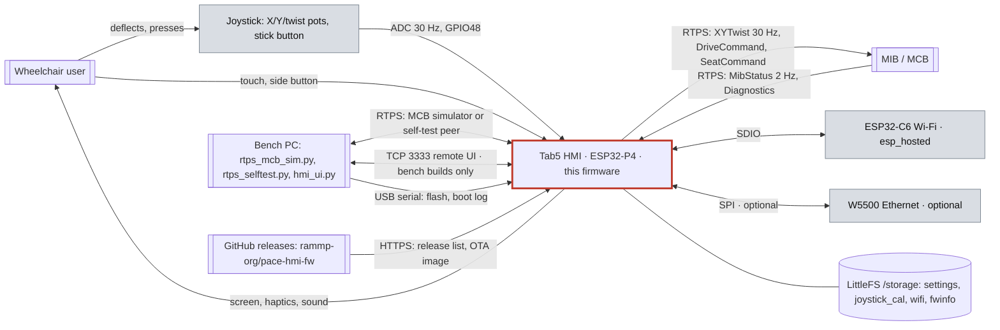
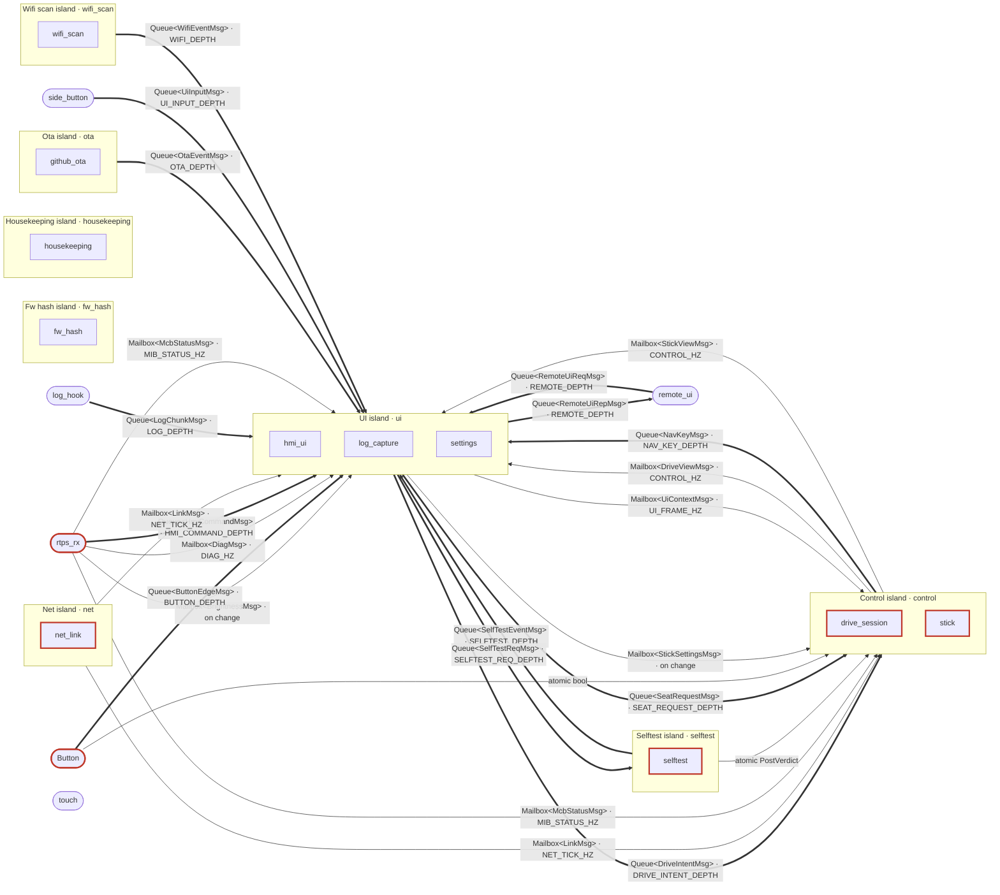
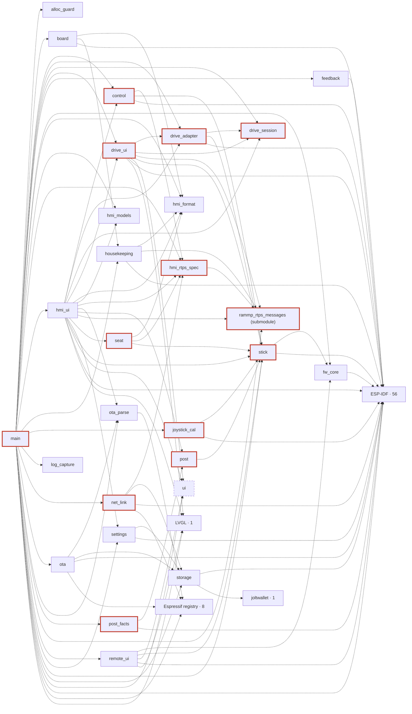

# Architecture: pace-hmi-fw

Generated sections are rewritten by `tools/gen_diagrams` and checked by its `check` mode in L0
(CS-ARC-02; the "Diagrams" step of `.github/workflows/l0.yml`).
Do not edit between the markers. Regenerate with `python tools/gen_diagrams/gen_diagrams.py write`;
see [tools/gen_diagrams/README.md](../tools/gen_diagrams/README.md).

## Today vs target

The firmware as it runs today, every task and every channel between them, is one diagram in
[fw-overview.md](fw-overview.md); all of its testing is one diagram in
[testing-overview.md](testing-overview.md). For a file-by-file walk through the code (boot,
tasks, the motion path, the drive state machine, where each part of the old `main.cpp` went),
read [how-the-firmware-works.md](how-the-firmware-works.md).

- **Today** (the release candidate `dev_ai_rc`, 2026-10-15): `main` wires and the work lives
  in `components/*` (no `frag_*.inc` fragments any more). `main.cpp` builds the UI, stick and
  housekeeping islands from their `Config`s; its wiring files fill the UI's ports (`ui_ports`,
  `cues`), the stick task's I/O (`stick_io`), the task configs (`task_configs`), the bench verbs'
  hooks (`bench_hooks`) and the self test's probes (`selftest_platform`). The network link and
  RTPS are `net_link`, the log ring `log_capture`, the POST's (power-on self test's) ESP-IDF facts `post_facts`; the
  extended self test and the calibration adapter stay in `main/` as approved deviations. No espp
  component is vendored: espp comes as it is, on the RC from a local espp worktree with the
  drafted espp PRs (TEST ONLY, see [plans/progress.md](plans/progress.md)). Tasks share state through atomics, `fw_core` channels (the
  output permit's `AtomicValue`s, the POST rest-window `Mailbox`, the bench stick injection's
  `Mailbox`), LVGL subjects and a global recursive `lvgl_mutex`. The quick POST (`post`) is
  wired; `topology` is built and tested but not wired, so **D2 below is the target, not
  today's tasks**: today's are in [fw-overview.md](fw-overview.md).
- **Target:** the islands, adapters and channels of
  [docs/plans/refactor.md §2.1–2.3](plans/refactor.md#2-target-design), wired by
  `components/topology/include/topology.hpp`. D2 below is generated from that file; D3 grows as
  components move out of `main`. The target sketches of D2 and D3 are in
  [§2.5](plans/refactor.md#25-diagrams).
- D4 (state machines inside a component): the drive session's is drawn by hand in
  [components/drive_session/TABLE.md §5](../components/drive_session/TABLE.md#5-d4-state-diagram-drawn-by-hand-from-2),
  the stick monitor's in [components/stick/README.md](../components/stick/README.md), the
  POST's overall state in [components/post/README.md](../components/post/README.md). The link
  and seat tables are still drafts in
  [§2.4](plans/refactor.md#24-safety-state-machines-transition-tables).

## Legend (CS-ARC-03)

| Element | Mermaid |
| --- | --- |
| island | `subgraph` titled `<Name> island · <task>` |
| adapter | stadium `A([name])` |
| component | rectangle `C[name]` |
| peer or external system | subroutine `P[[name]]` |
| storage | cylinder `S[(name)]` |
| hardware / safety-relevant / generated | `:::hw` / `:::safety` / `:::gen` |
| mailbox (state) | solid arrow, label `Mailbox#lt;T#gt; · rate` |
| queue (event) | thick arrow `==>`, label `Queue#lt;T#gt; · depth` |
| dependency (D3) | dotted arrow `-.->` |

Every diagram ends with these lines:
```
classDef hw fill:#d9dde3,stroke:#7a8590,color:#111
classDef safety stroke:#c0392b,stroke-width:3px
classDef gen stroke-dasharray:5 4
```

## D1 Context (hand-written)

The HMI (human-machine interface) is the joystick and touch screen of a powered wheelchair. It
sends motion and seat commands to the MIB/MCB (Meebot interface board / main control board, the
chair's motor controller) over RTPS (Real-Time Publish-Subscribe) and shows the chair's state. The network is either Wi-Fi
(the Tab5's ESP32-C6 over SDIO) or Ethernet (an optional W5500 on the M5-Bus SPI lines), one at a
time, chosen on the Internet Settings screen. The bench PC tools stand in for the MCB and drive the
screen in test builds.



Sources for D1: `components/net_link/src/rtps_comms.cpp` (Wi-Fi or W5500, one link), `components/hmi_rtps_spec/include/hmi_rtps_spec.hpp`
(`kMibStatusPeriod` 500 ms, bench topics), the stick task's 33 ms ADC period, `components/ota/src/github_ota.cpp`,
`components/remote_ui/src/remote_ui.cpp` (`CONFIG_HMI_REMOTE_UI`), `components/storage`, and the Bench section of
[project-profile.md](project-profile.md).

## D2 Islands
<!-- BEGIN GENERATED D2 (tools/gen_diagrams): do not edit -->
Islands (subgraphs), adapters (stadiums) and channels from `components/topology/include/topology.hpp`. Components inside an island are those its COMPONENTS rows assign to the island's task.


<!-- END GENERATED D2 -->

## D3 Components
<!-- BEGIN GENERATED D3 (tools/gen_diagrams): do not edit -->
First-party components (`main` and `components/*` except `joystick`, `m5stack-tab5`, `ui`) and their direct `REQUIRES`/`PRIV_REQUIRES`. Vendored, generated and submodule components appear only as targets. Third-party dependencies are folded into one node per source; the number is how many of its components are used directly.



<details><summary>Folded dependencies</summary>

- **ESP-IDF**: `adc`, `app_update`, `base_component`, `base_peripheral`, `bmi270`, `bootloader_support`, `button`, `cdr`, `cli`, `codec`, `display`, `display_drivers`, `drv2605`, `esp_app_format`, `esp_driver_gpio`, `esp_driver_ppa`, `esp_driver_spi`, `esp_eth`, `esp_event`, `esp_http_client`, `esp_mm`, `esp_netif`, `esp_partition`, `esp_timer`, `esp_wifi`, `file_system`, `filters`, `format`, `freertos`, `gt911`, `i2c`, `ina226`, `input_drivers`, `interrupt`, `joystick`, `led`, `log`, `logger`, `lwip`, `m5stack-tab5`, `math`, `mbedtls`, `pi4ioe5v`, `pthread`, `reflect_cpp`, `rtps`, `rx8130ce`, `sdcard`, `socket`, `spi`, `spi_flash`, `st7123touch`, `task`, `thread_pool`, `timer`, `touch`
- **Espressif registry**: `espressif__cjson`, `espressif__esp-dsp`, `espressif__esp_hosted`, `espressif__esp_sccb_intf`, `espressif__esp_wifi_remote`, `espressif__usb`, `espressif__usb_host_uvc`, `espressif__w5500`
- **joltwallet**: `joltwallet__littlefs`
- **LVGL**: `lvgl__lvgl`

</details>

Source: `docs/diagrams/project_components.json`, a path-free snapshot of an ESP-IDF build's `project_description.json`. Regenerate after a build with `python tools/gen_diagrams/gen_diagrams.py write --build-dir <idf build dir>`.
<!-- END GENERATED D3 -->

Snapshot taken from the RC's bench build of `ba2c7b3` (2026-10-15). On the RC every espp
component is an `override_path` to a folder outside the project, so the generator cannot tell
it from ESP-IDF and folds it into the **ESP-IDF** node. The espp ones in that list are `adc`,
`base_component`, `base_peripheral`, `bmi270`, `button`, `cdr`, `cli`, `codec`, `display`,
`display_drivers`, `drv2605`, `file_system`, `filters`, `format`, `gt911`, `i2c`, `ina226`,
`input_drivers`, `interrupt`, `joystick`, `led`, `logger`, `m5stack-tab5`, `math`, `pi4ioe5v`,
`reflect_cpp`, `rtps`, `rx8130ce`, `sdcard`, `socket`, `spi`, `st7123touch`, `task`,
`thread_pool`, `timer` and `touch`. With espp from the component manager they fold into an
**espp** node again.
