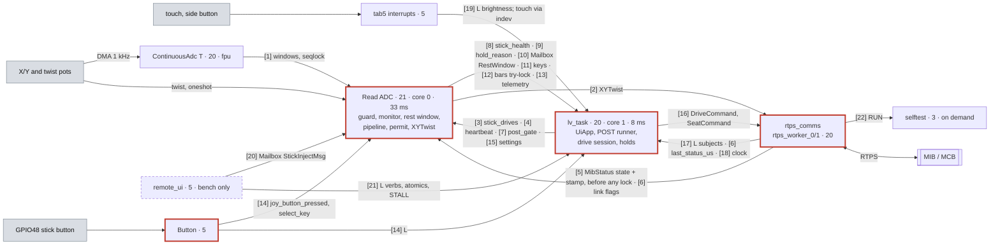

# Firmware overview: one page, one diagram

The whole of pace-hmi-fw on one page: every task, every component, and every path by which one
task tells another something, each labelled with its mechanism. Read this first. The detail
behind each box is in [how-the-firmware-works.md](how-the-firmware-works.md); the tests are in
[testing-overview.md](testing-overview.md).

Checked against `dev_ai_hazard_candidate` at `46f5719` (2026-10-11): `dev_refactor` plus the
hazard fixes C1, C3, C4, C2 and C2b, and the two priority changes (RTPS workers and the
ContinuousAdc task at priority 20). Task values are `tools/guards/baselines/tasks.json` (G10),
checked against the code. Where the code does not say, this page says "not shown".

## 1. The diagram

Numbers in brackets, `[7]`, are the channels in [§2](#2-the-channels): who writes, who reads,
and how. `L` on an arrow means "takes `lvgl_mutex`". Task boxes give `priority . core . stack`;
`fpu` means "no core asked: pinned to the core of its first FPU use, boot-dependent".

```text
HARDWARE: X/Y pots (ADC1 CH0/CH1)   twist (ADC2 CH3)    GPIO48 stick button     touch panel, side button
                |  DMA 1 kHz            | 8 oneshot           | edge                  | GT911 / PI4IOE interrupt
                v                       | reads/cycle         v                       v
+---------------+---------------+       |        +------------+--------------+ +------+-------------------------+
| ContinuousAdc T 20 . fpu . 4K |       |        | Button  5 . any . 4K      | | tab5 interrupts  5 . any . 4K  |
| espp_adc (vendored): 128 ms   |       |        | stick_button_edge():      | | board::TouchClick: a click     |
| windows: mean, max, sequence  |       |        | takes L, then StickButton | | board::SideButton: brightness  |
+---------------+---------------+       |        +------+-------------+------+ +----+---------------------+-----+
                | [1] seqlock, no lock  |               | [14]        | [14] L      | [19] no lock        | L
                v                       v               v atomics     |             v                     |
+-----------------------------------------------------------+         |         feedback: sound, haptics  |
| Read ADC  21 . core 0 . 6K . waits 33 ms after each cycle |         |                                   |
| control::StickIsland -> ControlCycle, every cycle:        |         v                                   v
|  a. read X/Y windows + twist                              |   +-----+-----------------------------------+------+
|  b. MotionGuard (C4) <- heartbeat [4], MibStatus [5],     <--+| lv_task  20 . core 1 . 16K . every 8 ms        |
|     link flags [6], watchdog subscription [25]            |   | hmi_ui::UiIsland: lvgl_cycle() holds L         |
|  c. [bench] inject [20]; MonitorCycle (C2) -> [8]         +-->| around lv_task_handler(): every view, timer,   |
|  d. RestWindow (C3) -> Mailbox<RestWindowMsg> [10]        +-->| observer, input read and flush                 |
|  e. StickPipeline: calibration, map, mount,               |   | 250 ms UiPoll: link state -> diagnostics       |
|     arrow keys [11]; Joystick bars, try-lock L [12]       +-->|   -> POST tick (PostStage, writes [7])         |
|  f. OutputPermit (C1): 1 gate [3], 2 guard OK,            <--+|   -> drive tick (DriveAdapter, DriveSession,   |
|     3 no calibration run, 4 measured calibration,         |   |      DrivePort) -> POST indicator -> theme     |
|     5 POST PASS [7], 6-7 stick health OK [8],             <--+| 33 ms hold poll: ENTRY_PUSH, unlock, exit and  |
|     8 centred 300 ms; else hold reason [9]                +-->|   calibrate holds; Drive notice <- [9]         |
|  g. XYTwist = stick x speed/10, or a literal 0;           |   | DriveUi::update_stick_gate writes [3]          |
|     button bit only after POST PASS                       |   | after every cycle: heartbeat [4], watchdog     |
|  h. note_cycle (self test); watchdog reset [25]           |   |   reset [25]; settings rows write [15]         |
|  telemetry [13] -> lv_task, selftest, remote_ui           +-->| reads [8] [10] [11]; keypad, touch, remote     |
|  settings read [15], button [14], calibration [26]        <--+|   pointer                                      |
+-------+-------------------+-------------------------------+   +---------+-----------------------------------+--+
        ^                   |                                             |                                   ^
        | [5] [6]           | [2] XYTwist, every cycle                    | [16] DriveCommand,  [17] L:       |
        | atomics           |     (endpoints_mutex)                       |      SeatCommand    MibStatus,    |
        |                   v                                             v                     subjects      |
+-------+-------------------+---------------------------------------------+-----------------------------------+--+
| rtps_comms (main/rtps_comms.cpp): the network link and one espp RTPS participant (5 writers, 4 readers)        |
|  rtps_worker_0/1  20 . fpu . 6K  espp thread pool, raised 5 -> 20 by raise_rtps_workers(): sends every         |
|                   publish and runs every subscriber callback                                                   |
|  rtps_reactor 5 . any . 6K   rtps_protocol 5 . fpu . 4K   rtps_start 5 . fpu . 8K (one-shot: IP, start)        |
|  rtps_pub 5 . any . 8K: heartbeat every 2 s; rebinds RTPS when the IP changes                                  |
|  on_mib_status: stamp last_status_us [6] -> guard state + stamp [5] -> SystemClock [18] -> L [17]              |
+-------------------------------------------------+--------------------------------------------------------------+
                                                  | RTPS over UDP: W5500 Ethernet (SPI) or ESP32-C6 Wi-Fi
                                                  | (esp_hosted sdio_* and rpc_* 23, tcpip 18, sys_evt 20)
                                                  v
    out: XYTwist, DriveCommand, SeatCommand, hmi/counter, selftest/report       [[ MIB / MCB ]]
    in:  MibStatus every 500 ms, Diagnostics, hmi/command, hmi/brightness       [[ bench PC ]]

ON THE SIDE (channels: section 2)
  main         1 . core 0 . 33K  app_main: builds and starts everything (section 3), then sleeps for good
  remote_ui    5 . any . 16K     bench builds only, TCP 3333: [20] [21], verbs take L
  selftest     3 . core 0 . 12K  on demand (Skunk Works tile or hmi/command RUN) [22]; overlay under L
  Data Display 10 . core 1 . 6K  housekeeping: RTC, battery, IMU every 20 ms; publishes nothing
  fw_hash      2 . any . 6K      once: SHA-256 of the image (fw_info, own mutex) for About
  github_ota   3 . any . 12K     on demand: download, install (status under its own mutex) [23]
  update_ui, internet_ui  5 . any . 12K / 8K   on demand workers: lv_async_call under L [23]
  tab5_audio, tab5_audio microphone  20 . core 1 . 8K   BSP: I2S speaker and microphone
  log capture  every task's stdout -> 500-line ring (ring_mutex) -> Log screen [24]
  joystick_cal  calibration run on lv_task -> Read ADC: running flag, pending copy (cal_mutex) [26]
  ESP-IDF      ipc0/1 24, esp_timer 22 . core 0, sys_evt 20 . core 0 (Ethernet and IP events -> [6]),
               tcpip 18, esp_hosted sdio_* and rpc_* 23 (Wi-Fi from the C6), IDLE0/1 0
```

The same picture in Mermaid (renders on GitHub; the numbers are the same channels):



## 2. The channels

Mechanisms: `std::atomic` (lock-free, one writer); `fw::AtomicValue<T>` (fw_core: a lock-free
value, release on store, acquire on load); `fw::Mailbox<T>` (fw_core: a one-slot FreeRTOS queue
written with `xQueueOverwrite`; the writer never blocks, the one reader gets the newest value
and CHANGED once per write; its read end is bound to one task); `lvgl_mutex` (one global
`std::recursive_mutex` in `main.cpp`); a plain `std::mutex` inside a component. `fw::Queue` is
built and tested but used by no task yet. Only `lvgl_mutex` can make one task wait for another
(and Read ADC only ever tries it); every other channel is lock-free or a short component mutex,
and every reader polls at its own rate: nothing is event-driven between tasks.

| # | What | Mechanism | Writer (task) | Reader (task) | Used for |
| --- | --- | --- | --- | --- | --- |
| 1 | X/Y windows: mean, max, sequence | seqlock in `adc_window` (lock-free; a torn read is retried) | ContinuousAdc T | Read ADC (`WindowedContinuousAdc::get_windows`) | the stick's X/Y, and C2's freshness check |
| 2 | XYTwist `{x, y, twist, buttons}` | `rtps_comms_publish_adc` → `endpoints_mutex` → espp Publisher | Read ADC, every cycle | rtps_worker (sends) | motion; a literal 0 when held |
| 3 | `stick_drives` (the gate) | `std::atomic<bool>` | lv_task (`DriveUi::update_stick_gate`) | Read ADC (permit condition 1; guard counter) | stick drives only on Drive, unlocked, menu shut |
| 4 | UI heartbeat; UI watchdog subscribed | `GuardSources::ui_heartbeat` (u32 ms stamp, release/acquire); `ui_wdt_ok` (`std::atomic<bool>`) | lv_task, after every cycle; once | Read ADC (motion guard) | UI_STALE at 200 ms; WDT_MISSING |
| 5 | MCB state and MibStatus stamp | `GuardSources::mcb_state` (relaxed) then `mcb_rx` (release) | rtps_worker, first step of the MibStatus handler, before any lock | Read ADC (motion guard) | MCB_NOT_ENABLED; MIB_STALE at 2000 ms |
| 6 | Link flags; MibStatus arrival | `net_failed`, `link_up`, `got_ip` (`std::atomic<bool>`); `last_status_us` (`std::atomic<int64_t>`) | sys_evt (Ethernet/IP events), rtps_start, app_main; rtps_worker | Read ADC (LINK_DOWN); lv_task (`rtps_comms_link_state`: CONNECTED = a MibStatus in the last 2 s) | the guard; the link subject; the drive session's samples |
| 7 | POST gate NOT_RUN/PENDING/PASS/FAIL | `PermitHooks::post_gate`, `fw::AtomicValue<PostGate>` | lv_task (`PostStage`, the POST runner; its only writer) | Read ADC (permit 5, button bit, rest window); lv_task (drive table `POST_OK`) | no motion, no ENABLE before POST PASS |
| 8 | Stick health NOT_MONITORED/OK/CHECK/FAULT | `PermitHooks::stick_health`, `fw::AtomicValue` | Read ADC (C2 monitor, every cycle) | Read ADC (permit 6, 7); lv_task (drive table `STICK_FAULT`, TopBar indicator, Joystick words) | stick fault handling |
| 9 | Hold reason (why the stick is held) | `PermitHooks::hold_reason`, `fw::AtomicValue` | Read ADC (the permit) | lv_task (Drive notice every 33 ms; drive sample) | the Drive screen's notice |
| 10 | POST rest window | `fw::Mailbox<RestWindowMsg>` (`RestWindowMailbox`) | Read ADC, every 30 cycles until the gate is PASS or FAIL | lv_task (POST runner, 250 ms) | POST's stick-at-rest checks |
| 11 | Stick as arrow keys | `joy_key`, `joy_flick` (`std::atomic<uint32_t>`) | Read ADC (remote_ui writes `joy_key` too) | lv_task (keypad read) | menu navigation |
| 12 | Joystick screen bars | `try_lock(lvgl_mutex)`, then `lv_subject_set_int` | Read ADC (skips the update if the lock is busy) | lv_task (observers) | never blocks the stick |
| 13 | Guard and monitor telemetry | `GuardTelemetry`, `MonitorTelemetry` (relaxed atomics) | Read ADC | lv_task (stick log), selftest, remote_ui STATE | observability only |
| 14 | Stick button | `stick_button_edge`: takes `lvgl_mutex` (blocking), then `StickButton::edge` writes the pressed subject, `joy_button_pressed`, `select_key` (`std::atomic<bool>`) | Button (and remote_ui BTN) | Read ADC (XYTwist button bit, rest window); lv_task (holds, ENTER) | the button bit waits for the lock |
| 15 | Settings other tasks need | `applied_settings` (`AppliedSettings` atomics: sensitivity, speed, invert, swap, sounds) | lv_task (`UiApp::store_setting`) | Read ADC; the click sound | mount, keys, speed scale |
| 16 | DriveCommand, SeatCommand | `rtps_comms_publish_drive` / `_seat` (`LinkPort`), `endpoints_mutex`; each send best effort, no acknowledgement; the drive session re-sends a stop every 250 ms until the MCB stops | lv_task (`DrivePort::publish`, `UiApp::seat_request`) | rtps_worker (sends) | ask the MCB to drive, stop, move the seat |
| 17 | MibStatus, Diagnostics, brightness into the UI | handler takes `lvgl_mutex` (blocking), `RtpsUiBridge` writes subjects; observers run on the worker | rtps_worker | lv_task (subjects) | bands, banners, `mcb_ready`, the drive session's samples |
| 18 | Wall clock | `SystemClock::note_mcb_time` (system time, RTC), `clock_valid` (`std::atomic<bool>`) | rtps_worker (outside the lock) | lv_task (TopBar) | the clock |
| 19 | Touch, side button | `TouchClick` clicks without a lock; `SideButton` → `brightness_step` under `lvgl_mutex`; touch points through LVGL's indev, read on lv_task | tab5 interrupts | feedback; lv_task | |
| 20 | Bench stick injection | `fw::Mailbox<StickInjectMsg>`; back: `fw::AtomicValue<bool>` (the "STICK INJECTED" marker) | remote_ui (STICK); Read ADC | Read ADC (`StickInjectBench::inject`); remote_ui marker on lv_task | bench builds with `CONFIG_HMI_BENCH_STICK_INJECT` only |
| 21 | Remote UI verbs | SHOT, TAP, PRESS, RELEASE, SWIPE, KEY, SCREEN, FOCUS, THEME take `lvgl_mutex`; KEY → `remote_key` + `joy_key`; BTN → [14]; STATE reads atomics (the drive adapter's phase/notice mirrors, menu and banner mirrors, permit hooks, telemetry, `PostStage::shown`); PERMIT POST, POST RERUN → `PostStage` request (`fw::AtomicValue`, applied on the runner's next tick); STALL → `BenchStall` atomics; CAL UNSAVED; CRASH | remote_ui | lv_task, Read ADC | bench builds only (`CONFIG_HMI_REMOTE_UI`); the hazard verbs need stick-inject builds |
| 22 | Self test | `rammp/hmi/command` RUN → `selftest_request` creates the `selftest` task; overlay under `lvgl_mutex`; report on `rammp/selftest/report` | rtps_worker; the Skunk Works tile (lv_task) | selftest | 60 checks, on demand |
| 23 | Worker results to the UI | `lv_async_call` under `lvgl_mutex`; OTA status behind `github_ota`'s own mutex, polled | update_ui, internet_ui, github_ota | lv_task | Update and Internet screens |
| 24 | Log | stdout/stderr tee → 500-line PSRAM ring (`ring_mutex`) | every task | lv_task (Log screen, 250 ms) | |
| 25 | Task watchdog | `esp_task_wdt_add` at the first cycle, `esp_task_wdt_reset` after every cycle; 2 s; reports only (`CONFIG_ESP_TASK_WDT_PANIC` off), idle-task checks off | Read ADC, lv_task | ESP-IDF | a failed subscription holds the stick (WDT_MISSING) |
| 26 | Calibration hand-off | `running`, `generation` (`std::atomic`); finished record behind `cal_mutex` (`joystick_cal_take_new`) | lv_task (the calibration run, 33 ms timer) | Read ADC, once per cycle | keys silent and the stick held while it runs |

## 3. What `main` does

`main/main.cpp`'s `app_main` runs on IDF's `main` task (priority 1, core 0). It only builds and
wires: every component gets a `Config`, and main fills the ports the components call out
through. Bring-up order (details and line numbers: [how-the-firmware-works.md §3](how-the-firmware-works.md#3-boot-app_main-step-by-step)):

```text
log capture, storage migration, OTA boot report
-> Board: I2C probe, Feedback (DRV2605), IO expanders, display      (a failure parks main: no UI)
-> LVGL DIRECT render into the DSI frame buffers, refresh 16 ms
-> Housekeeping object, IMU, uSD, SystemClock + RTC, battery, audio, side button  (side button live)
-> build_screens, UiApp::build (settings, subjects, chrome, banners, 250 ms poll)
-> GPIO48 Button task (live), keypad indev, UiApp::build_input (holds, screens, boot->Locked 1.2 s)
-> selftest_init (registers its RTPS handlers), UiApp::build_on_demand_parts
-> touch; RestWindow mailbox + Read ADC state; PostStage::attach; UiIsland::start (lv_task runs)
-> click sound (a failed load only logs), housekeeping task, espp::joystick_selftest
-> StickIsland: ContinuousAdc + twist ADC up; calibration loaded; Read ADC task starts
-> RTPS handlers (brightness, MibStatus with the guard stamp, diagnostics); rtps_comms_start
-> TopBar link label; fw_info_start (fw_hash); [bench] bench verbs; remote_ui_start
-> park_main_task(): sleeps for good, so every local it built lives
```

The ports `main` implements (`components/hmi_ui/include/hmi_ui/app_ports.hpp`, `post_stage.hpp`):

| Port | Filled with | Called by |
| --- | --- | --- |
| `kLinkPort` | `rtps_comms_link_state`, link-change log, Wi-Fi?, network setting text, diagnostics stats, `rtps_comms_publish_drive`, `rtps_comms_publish_seat` | lv_task |
| `kDriveInputs` | the one `DriveAdapter`'s `input`, `tick`, `unlock_hold_done`, `exit_hold_done`, `refresh_notice` | lv_task |
| `kCuesPort` | click, refusal sound, refusal haptic, STRONG_CLICK, haptic test | lv_task (and rtps_worker through banner sounds) |
| `kSelfTestPort` | overlay visible, dismiss, run | lv_task |
| `kBoardPort` | backlight, present (the flush's buffer swap), restart | lv_task |
| `kMainScreens` | the Log, Internet, About, Update and calibration screens main keeps | lv_task |
| `kPostPort` | ms clock, `esp_reset_reason`, OTA image state, calibration, heap and stack headroom, calibration saved, `stick_task_running` | lv_task (POST runner) |
| `AdcStickIo` | everything one stick cycle reads and writes outside itself: [3] [7] [8] [9] [10] [11] [12] [14] [15] [26], the permit and the publish | Read ADC |
| `StickPorts` | the ADC clock (`esp_timer` ms), TWDT subscribe/reset, the bench STALL | Read ADC |
| `UiIsland::Config` | `lvgl_cycle`, the heartbeat [4], TWDT subscribe/reset | lv_task |
| `drive_port` | `hmi::ui::DrivePort<DriveUi>`: each drive action as its LVGL or DriveCommand call | lv_task |

## 4. Components

| Component | Runs on | Job |
| --- | --- | --- |
| `control` | Read ADC | `StickIsland` (the task, the ADC reads), `ControlCycle`, `MotionGuard` (C4), `BenchStall` |
| `stick` | Read ADC | `StickPipeline`, `StickMonitor`/`MonitorCycle` (C2), `OutputPermit` (C1), `PermitHooks`, bench injection parser |
| `espp_adc`, `adc_window` | ContinuousAdc T, Read ADC | espp's continuous ADC (vendored) with the lock-free window snapshot |
| `joystick`, `joystick_cal` | Read ADC, lv_task | espp's joystick mapping (vendored, + twist); the calibration record and run model |
| `post` | lv_task (runner), Read ADC (rest window) | the quick POST: 19 checks, latched or live, budget 3 s |
| `drive_session` | lv_task | the 59-row drive table and `DriveSession::step` (pure) |
| `drive_adapter` | lv_task | `DriveAdapter<Port>`: samples, deadlines, stop re-send, performs actions |
| `drive_ui` | lv_task | `DrivePort`, `DriveUi` (padlock, gate writer), `StickButton` |
| `hmi_ui` | lv_task | `UiApp` and every view, `UiIsland`, `UiPoll`, `PostStage`, `RtpsUiBridge`, holds, nav |
| `ui` | lv_task | the SquareLine export (generated, never edited) |
| `hmi_format`, `hmi_models` | lv_task | pure text formatting; grid cursor, bench PIN |
| `hmi_rtps_spec`, `external/rammp-rtps` | all | topics, messages, timeouts, texts shared with the MIB/MCB |
| `board`, `m5stack-tab5` | main, tab5 interrupts | Tab5 bring-up; the BSP (vendored, changed) |
| `feedback` | lv_task, tab5 interrupts, rtps_worker | DRV2605 haptics, click sound |
| `housekeeping` | Data Display Task, rtps_worker | IMU/battery/RTC loop; `SystemClock` |
| `settings`, `storage` | lv_task | the settings table, `AppliedSettings`; LittleFS `/storage` |
| `ota`, `ota_parse` | github_ota, fw_hash, update_ui | GitHub release OTA, image hash; pure parsers |
| `remote_ui` | remote_ui | bench TCP 3333 server, bench verbs, stick injection slot |
| `fw_core` | all | `Mailbox`, `AtomicValue`, `Queue`, `ThreadChecker`, `Owned`, `check` |
| `topology` | none (not linked) | the target task and channel map; feeds D2 in [architecture.md](architecture.md) |
| `main/` | main and the tasks it starts | wiring, `rtps_comms`, self test, log capture, calibration adapter, four screens |

## 5. A stick deflection becomes a motor command

The pots feed ADC1 (X, Y; ContinuousAdc T samples them at 1 kHz into 128 ms windows) and ADC2
(twist; Read ADC reads it 8 times a cycle). Every cycle Read ADC takes one snapshot of both X/Y
windows [1] and the twist, then runs one `ControlCycle`: the motion guard checks, from atomics
only, that the UI task cycled in the last 200 ms [4], the link is up [6], a MibStatus arrived in
the last 2 s and said ENABLED [5], and both tasks are on the watchdog [25]. The C2 monitor judges
the raw sample (missing, NaN, negative, above the calibrated end, stale X/Y, failed twist reads)
and writes stick health [8]; the POST rest window gets the reads [10]. `StickPipeline` maps the
millivolts through the calibration (dead zones, +Y forward), applies the mount (swap, invert),
updates the arrow keys [11] and the bars [12]. The output permit then lets the stick through only
if all eight conditions hold, in order: gate open [3], guard OK, no calibration running, a
measured calibration, POST PASS [7], stick health not FAULT and OK [8], and the stick centred for
300 ms since the last hold. Allowed, XYTwist carries `x, y, twist × speed/10`; held, it carries
a literal `(0, 0, 0)`; either way it goes out every cycle [2], and the first failing condition
is the hold reason the Drive screen shows [9]. The UI side opens the gate: the user's unlock hold
on Locked sends ENABLE (row 18: MCB ready, POST PASS, no stick fault), the MCB answers ENABLED in
MibStatus, the 250 ms tick unlocks (row 2), 1 s later the Drive screen fades in, and its
SCREEN_LOADED sets `stick_drives`. What the MCB does with XYTwist is not shown here: the motors
are the MCB's.

## 6. The MCB stops, or the user presses stop

**The MCB stops on its own** (or its MibStatus goes stale). The MibStatus handler on rtps_worker
stores the new state and its stamp [5] before it takes any lock, so the next Read ADC cycle's
guard reads MCB_NOT_ENABLED (or MIB_STALE once 2 s pass with none) and sends 0 within about one
cycle, whatever the UI task is doing. Then the handler takes `lvgl_mutex` and updates the
subjects [17]. On the next 250 ms tick the drive session relocks (rows 3-6): the Locked screen,
the gate shut, one DISABLE, and a DRIVE_STOPPED or DRIVE_LOST banner. Re-entering needs the stick
centred again (the permit's latch).

**The user presses stop** (the exit hold on Drive, 500 ms grace + 1 s fill, or the burger key).
Rows 21-22 / 25-26 send DISABLE, arm the 750 ms exit deadline and the stop timer. The MCB decides
(G4): until it leaves ENABLED the stick still drives, and the HMI re-sends DISABLE every 250 ms
(rows 46, 48), shows EXIT_REFUSED after 750 ms (row 14) and "MCB did not stop" after 5 s (rows
44-45), then re-sends at 1 Hz (rows 47, 49). Once a MibStatus says it stopped, the guard sends 0
on the next ADC cycle and the tick relocks (rows 7-9; the burger key's menu opens over Locked).
A latched stick FAULT stops the same way on its own (rows 55-56), and the permit already holds
the stick at 0.
