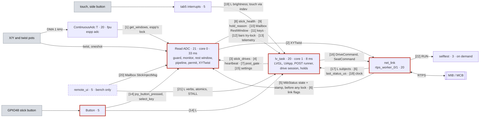

# Firmware overview: one page

The whole of pace-hmi-fw on one page: every component, every task, and every path by which one
task tells another something. Read this first. The detail behind each box is in
[how-the-firmware-works.md](how-the-firmware-works.md); the tests are in
[testing-overview.md](testing-overview.md).

Checked against the release candidate (RC) branch `dev_ai_rc` on 2026-10-15. The RC is
**TEST-ONLY**: it builds against local espp branches (below), so CI cannot build it. Task values
come from `tools/guards/baselines/tasks.json` (guard G10, the task table), checked against the
code. Where the code does not say, this page says "not shown".

## 0. Words used

| Term | Meaning |
| --- | --- |
| HMI | human-machine interface: this Tab5 (ESP32-P4) with its joystick and touch screen |
| MIB / MCB | Meebot interface board / main control board (the motor driver). For this HMI they are one peer: the chair's controller. It decides whether the chair drives |
| RTPS | Real-Time Publish-Subscribe, the wire protocol under DDS (Data Distribution Service); espp's `rtps` component. Messages: `XYTwist` (stick motion), `DriveCommand` (ENABLE/DISABLE), `SeatCommand`, `MibStatus` (the chair's state, every 500 ms), `Diagnostics` |
| espp | Espressif's open-source C++ component library (esp-cpp/espp): the Tab5 board support package (BSP), the ADC, RTPS, joystick, logger, task and more |
| LVGL | Light and Versatile Graphics Library, the UI toolkit. `lv_*` calls touch it |
| POST | power-on self test: the quick boot check (`components/post`), 19 checks, gates motion |
| ADC, DMA | analog-to-digital converter; direct memory access (the continuous ADC fills memory on its own) |
| TWDT | ESP-IDF's task watchdog timer |
| H1..H16 | the hazard IDs found in the refactor ([plans/refactor.md §1](plans/refactor.md)) |
| C1, C2, C2b, C3, C4 | the hazard-fix groups: C1 output permit and drive table, C2 stick monitor (C2b its stop while driving), C3 POST, C4 motion guard and watchdogs ([plans/hazard-fixes.md](plans/hazard-fixes.md)) |
| G1..G5, M1 | the owner's guards and decision of 2026-10-08: the MCB decides (M1) under guards G1-G5 (hazard-fixes.md §9) |
| T1, T4, T11, T12, E5 | numbered owner decisions ([plans/hazard-decisions.md](plans/hazard-decisions.md)) |
| J1, J2 | the two joystick items of the vendored-joystick review: J1 the twist mapped in our code, J2 the mapping self test at boot (both in `components/stick`) |
| PR 1-4, A, B, C, #738 | espp pull requests: 1 ADC window summary, 2 RTPS `matched_readers`, 3 RTPS publish without allocation, 4 RTPS worker priority, A Tab5 frame buffers, B Tab5 vsync present, C SD card shares the SDMMC host; #738 an upstream Tab5 display PR that A and B sit on |
| `[S]` | safety-relevant: it can command or stop motion, or hide a fault (`docs/project-profile.md`, Components) |

## 1. The firmware as a tree

Every first-party component, every file of `main/`, and the espp components used straight from
espp. `[S]` marks safety-relevant parts. "on X" names the task the code runs on.

```text
pace-hmi-fw  (ESP-IDF 6.0.0 project "rammp-hmi-p4", ESP32-P4 on the M5Stack Tab5)
|
+-- main/                         component "main" [S]: the composition. Builds, wires, starts; owns no behaviour
|   +-- main.cpp                  app_main (on IDF's "main" task); lvgl_mutex, the one LVGL lock; ui_app (the one
|   |                             UiApp, constinit); drive_port + drive_adapter (the drive session's adapter);
|   |                             the entry points other tasks reach the UI through (brightness_set,
|   |                             brightness_step, stick_button_edge, lvgl_cycle); AdcStickIo::show (the bars);
|   |                             the Internet/Update screen inits. Keeps every lv_* and lock call main owns
|   +-- ui_ports.hpp/.cpp         the UiApp's ports: kLinkPort, kDriveInputs, kSelfTestPort, kBoardPort,
|   |                             kMainScreens, kPostPort; the drive session's thunks; joystick_keypad_read
|   +-- cues.hpp/.cpp             kCuesPort: click, refusal, haptics over app_main's Feedback; load_audio
|   +-- stick_io.hpp/.cpp     [S] AdcStickIo (what one Read ADC cycle reads and writes outside the pipeline),
|   |                             StickPorts (clock, TWDT, bench STALL), kStickCycle (33 ms), stick_island_config,
|   |                             stick_calibration_at_boot
|   +-- task_configs.hpp/.cpp     the literal configs of lv_task, "Data Display Task", the GPIO48 "Button"
|   +-- bench_hooks.hpp/.cpp      the hazard bench verbs' hooks (stick-inject bench builds only)
|   +-- selftest_platform.*       the extended self test's board probes (I2C, haptics, display, guard, monitor)
|   +-- app_instances.hpp         extern ui_app, drive_adapter for the files above
|   +-- selftest*.cpp/.hpp    [S] the extended self test: 60 checks (+3 in alloc-guard builds), on demand
|   +-- joystick_cal.*        [S] the calibration screen's adapter (the run itself: components/joystick_cal)
|   +-- log_view, about_ui, internet_ui, update_ui   main's side of four screens
|   +-- boot_logo.c, click.wav, lv_mem_psram.c       generated logo, the click sound, LVGL's PSRAM heap
|
+-- components/   (first party)
|   +-- control        [S] on Read ADC: StickIsland (the task, the ADC reads), ControlCycle, MotionGuard (C4)
|   +-- stick          [S] on Read ADC: StickPipeline (mV -> keys + XYTwist), StickMonitor/MonitorCycle (C2),
|   |                      OutputPermit (C1), PermitHooks; the twist mapper (J1) and mapping_selftest (J2)
|   +-- post           [S] on lv_task: the POST evaluator and runner (C3); the rest window fed by Read ADC
|   +-- post_facts     [S] on lv_task: the POST's ESP-IDF facts (reset reason, image, heap, stacks, stick alive)
|   +-- drive_session  [S] on lv_task: the 59-row drive table and DriveSession::step (pure C++)
|   +-- drive_adapter  [S] on lv_task: DriveAdapter<Port>: samples, deadlines, stop re-send, actions
|   +-- drive_ui       [S] on lv_task: DrivePort (LVGL + DriveCommand), DriveUi (padlock, the stick gate's
|   |                      writer), StickButton (GPIO48 edges)
|   +-- seat           [S] on lv_task: the seat gate and the seat reading (header-only, constexpr)
|   +-- net_link       [S] on rtps_start/rtps_pub/RTPS workers: the network link (W5500 Ethernet or Wi-Fi
|   |                      through the ESP32-C6) and the one RTPS participant (rtps_comms.hpp)
|   +-- hmi_rtps_spec  [S] all: HMI topics, timeouts, seat units, banner texts, self-test tags
|   +-- joystick_cal   [S] lv_task, Read ADC: the calibration record, its file, check(), the run model
|   +-- hmi_ui             on lv_task: UiApp and every view, UiIsland (the UI task), UiPoll (250 ms),
|   |                      PostStage, RtpsUiBridge, NavView, HoldEngine, DisplayFlip (DIRECT render)
|   +-- ui                 on lv_task: the SquareLine export (generated, never edited)
|   +-- hmi_format, hmi_models   pure text formatting; grid cursor and bench PIN models
|   +-- board              on main, tab5 interrupts: Tab5 bring-up on the BSP; TouchClick, SideButton
|   +-- feedback           lv_task, tab5 interrupts, RTPS workers: DRV2605 haptics, the click sound
|   +-- housekeeping       on Data Display Task: IMU, battery, RTC every 20 ms; SystemClock
|   +-- settings, storage  lv_task: the settings table, AppliedSettings; LittleFS /storage
|   +-- log_capture        every task: stdout/stderr teed into a 500-line PSRAM ring for the Log screen
|   +-- ota, ota_parse     github_ota, fw_hash, update_ui: GitHub release OTA, image hash; pure parsers
|   +-- remote_ui          bench builds only: TCP 3333 server, bench verbs, stick injection slot
|   +-- alloc_guard        alloc-guard bench builds only: counts heap allocations of chosen tasks
|   +-- fw_core            all: Mailbox, AtomicValue, Queue, ThreadChecker, Owned, check
|   +-- topology           not linked: the target task/channel map; feeds diagram D2 in architecture.md
|
+-- external/rammp-rtps  [S] submodule: the RTPS messages and topics shared with the MIB/MCB
|
+-- espp (third party, used as it is; nothing vendored)
    RC, TEST-ONLY: every espp/* is an override_path in main/idf_component.yml to the local worktree
    ~/Documents/ATDev/w/espp-738 (branch test-all-on-738 = espp main v1.3.8 + #738 + PR 1-4, A, B, C)
    +-- adc            ContinuousAdc (X/Y at 1 kHz, its own "ContinuousAdc T" task), OneshotAdc (twist);
    |                  PR 1: get_windows() = mean, max, count, sequence per channel, under espp's lock
    +-- rtps           the RTPS participant and its tasks; PR 2 matched_readers(), PR 3 publish without a
    |                  string, PR 4 worker priority in RtpsParticipant::Config
    +-- m5stack-tab5   the Tab5 BSP: display (PR A two frame buffers, PR B vsync present), touch, audio,
    |                  IMU, RTC, battery, uSD (PR C)
    +-- joystick       espp::Joystick, 2-axis (X/Y); the twist is mapped in components/stick (J1)
    +-- logger, task, filters, button, drv2605, format, cdr, file_system, ... (36 in all)
```

Other dependencies: LVGL 9.5.0, Espressif's `w5500`, `esp_wifi_remote` and `esp_hosted` (Wi-Fi
on the ESP32-C6 over SDIO), `cjson`, `esp-dsp`, `littlefs`. The component dependency graph
(D3) is generated in [architecture.md](architecture.md).

## 2. Tasks and data flow

Numbers in brackets, `[7]`, are the channels in [§3](#3-the-channels): who writes, who reads,
and how. `L` on an arrow means "takes `lvgl_mutex`". Task boxes give `priority . core . stack .
period`; `fpu` means "no core asked: pinned to the core of its first floating-point use, which
differs from boot to boot". Higher priority wins; 24 is the highest.

```text
HARDWARE: X/Y pots (ADC1 CH0/CH1)   twist (ADC2 CH3)    GPIO48 stick button     touch panel, side button
                |  DMA 1 kHz            | 8 oneshot           | edge                  | GT911 / PI4IOE interrupt
                v                       | reads/cycle         v                       v
+---------------+---------------+       |        +------------+--------------+ +------+-------------------------+
| ContinuousAdc T 20 . fpu . 4K |       |        | Button  5 . any . 4K      | | tab5 interrupts  5 . any . 4K  |
| espp adc: 1024 B DMA windows  |       |        | stick_button_edge():      | | board::TouchClick: a click     |
| mean, max, count, sequence    |       |        | takes L, then StickButton | | board::SideButton: brightness  |
+---------------+---------------+       |        +------+-------------+------+ +----+---------------------+-----+
                | [1] get_windows()     |               | [14]        | [14] L      | [19] no lock        | L
                v     (espp's lock)     v               v atomics     |             v                     |
+-----------------------------------------------------------+         |         feedback: sound, haptics  |
| Read ADC  21 . core 0 . 6K . waits 33 ms after each cycle |         |                                   |
| control::StickIsland -> ControlCycle, every cycle:        |         v                                   v
|  a. read X/Y windows + twist                              |   +-----+-----------------------------------+------+
|  b. MotionGuard (C4) <- heartbeat [4], MibStatus [5],     <--+| lv_task  20 . core 1 . 16K . every 8 ms        |
|     link flags [6], watchdog subscription [25]            |   | hmi_ui::UiIsland: lvgl_cycle() holds L         |
|  c. [bench] inject [20]; MonitorCycle (C2) -> [8]         +-->| around lv_task_handler(): every view, timer,   |
|  d. RestWindow (C3) -> Mailbox<RestWindowMsg> [10]        +-->| observer, input read and flush                 |
|  e. StickPipeline: calibration, map (X/Y espp::Joystick,  |   | 250 ms UiPoll: link state -> diagnostics       |
|     twist own mapper, J1), mount, arrow keys [11];        |   |   -> POST tick (PostStage, writes [7])         |
|     Joystick bars, try-lock L [12]                        +-->|   -> drive tick (DriveAdapter, DriveSession,   |
|  f. OutputPermit (C1): 1 gate [3], 2 guard OK,            <--+|      DrivePort) -> POST indicator -> theme     |
|     3 no calibration run, 4 measured calibration,         |   | 33 ms hold poll: ENTRY_PUSH, unlock, exit and  |
|     5 POST PASS [7], 6-7 stick health OK [8],             <--+|   calibrate holds; Drive notice <- [9]         |
|     8 centred 300 ms; else hold reason [9]                +-->| DriveUi::update_stick_gate writes [3]          |
|  g. XYTwist = stick x speed/10, or a literal 0;           |   | after every cycle: heartbeat [4], watchdog     |
|     button bit only after POST PASS                       |   |   reset [25]; settings rows write [15]         |
|  h. note_cycle (self test); watchdog reset [25]           |   | reads [8] [10] [11]; keypad, touch, remote     |
|  telemetry [13] -> lv_task, selftest, remote_ui           +-->|   pointer                                      |
|  settings read [15], button [14], calibration [26]        <--+|                                                |
+-------+-------------------+-------------------------------+   +---------+-----------------------------------+--+
        ^                   |                                             |                                   ^
        | [5] [6]           | [2] XYTwist, every cycle                    | [16] DriveCommand,  [17] L:       |
        | atomics           |     (endpoints_mutex)                       |      SeatCommand    MibStatus,    |
        |                   v                                             v                     subjects      |
+-------+-------------------+---------------------------------------------+-----------------------------------+--+
| net_link (components/net_link/src/rtps_comms.cpp): the network link and one espp RTPS participant             |
|  (5 writers, 4 readers)                                                                                        |
|  rtps_worker_0/1  20 . fpu . 6K  espp thread pool, created at 20 by RtpsParticipant::Config (PR 4): sends     |
|                   every publish and runs every subscriber callback                                             |
|  rtps_reactor 5 . any . 6K   rtps_protocol 5 . fpu . 4K   rtps_start 5 . fpu . 8K (one-shot: IP, start)        |
|  rtps_pub 5 . any . 8K: heartbeat every 2 s; rebinds RTPS when the IP changes                                  |
|  on_mib_status: stamp last_status_us [6] -> guard state + stamp [5] -> SystemClock [18] -> L [17]              |
+-------------------------------------------------+--------------------------------------------------------------+
                                                  | RTPS over UDP: W5500 Ethernet (SPI) or ESP32-C6 Wi-Fi
                                                  | (esp_hosted sdio_* and rpc_* 23, tcpip 18, sys_evt 20)
                                                  v
    out: XYTwist, DriveCommand, SeatCommand, hmi/counter, selftest/report       [[ MIB / MCB ]]
    in:  MibStatus every 500 ms, Diagnostics, hmi/command, hmi/brightness       [[ bench PC ]]

ON THE SIDE (channels: section 3)
  main         1 . core 0 . 33K  app_main: builds and starts everything (section 4), then sleeps for good
  remote_ui    5 . any . 16K     bench builds only, TCP 3333: [20] [21], verbs take L
  selftest     3 . core 0 . 12K  on demand (Skunk Works tile or hmi/command RUN) [22]; overlay under L
  Data Display 10 . core 1 . 6K  housekeeping: RTC, battery, IMU every 20 ms; publishes nothing
  fw_hash      2 . any . 6K      once: SHA-256 of the image (fw_info, own mutex) for About
  github_ota   3 . any . 12K     on demand: download, install (status under its own mutex) [23]
  update_ui, internet_ui  5 . any . 12K / 8K   on demand workers: lv_async_call under L [23]
  tab5_audio, tab5_audio microphone  20 . core 1 . 8K   espp BSP: I2S speaker and microphone
  log_capture  every task's stdout -> 500-line ring (ring_mutex) -> Log screen [24]
  joystick_cal  calibration run on lv_task -> Read ADC: running flag, pending copy (cal_mutex) [26]
  ESP-IDF      ipc0/1 24, esp_timer 22 . core 0, sys_evt 20 . core 0 (Ethernet and IP events -> [6]),
               tcpip 18, esp_hosted sdio_* and rpc_* 23 (Wi-Fi from the C6), IDLE0/1 0
```

The same picture in Mermaid (renders on GitHub; the numbers are the same channels):



**The motion path in one line:** pots → ContinuousAdc T (X/Y) and Read ADC's oneshot reads
(twist) → Read ADC: motion guard (C4), stick monitor (C2), `StickPipeline`, output permit (C1)
→ `XYTwist` every 33 ms (the stick, or a literal 0) → `net_link` → RTPS workers → UDP → MCB.

**The UI path:** touch, the keypad (the stick as arrow keys) and the GPIO48 button → LVGL input
devices on lv_task → views in `hmi_ui` → the drive session (`DriveAdapter` →
`DriveSession::step` → `DrivePort`) → `DriveCommand` → `net_link` → MCB. The MCB's answer
(`MibStatus`) comes back on an RTPS worker: first into the motion guard (no lock), then into
LVGL subjects under `lvgl_mutex`.

## 3. The channels

Mechanisms: `std::atomic` (lock-free, one writer); `fw::AtomicValue<T>` (fw_core: a lock-free
value, release on store, acquire on load); `fw::Mailbox<T>` (fw_core: a one-slot FreeRTOS queue
written with `xQueueOverwrite`; the writer never blocks, the one reader gets the newest value
and CHANGED once per write; its read end is bound to one task); `lvgl_mutex` (one global
`std::recursive_mutex` in `main/main.cpp`); a plain `std::mutex` inside a component.
`fw::Queue` is built and tested but used by no task yet. In our code only `lvgl_mutex` can make
one task wait for another, and Read ADC only ever tries it. Inside espp, Read ADC's window read
[1] takes the ADC component's own lock (PR 1). Every reader polls at its own rate: nothing is
event-driven between tasks.

| # | What | Mechanism | Writer (task) | Reader (task) | Used for |
| --- | --- | --- | --- | --- | --- |
| 1 | X/Y windows: mean, max, sequence | espp `ContinuousAdc::get_windows()` (PR 1): both channels under espp's data lock, the one its reader task publishes under | ContinuousAdc T | Read ADC (`StickIsland::read_windows`) | the stick's X/Y, and C2's freshness check |
| 2 | XYTwist `{x, y, twist, buttons}` | `rtps_comms_publish_adc` → `endpoints_mutex` → espp Publisher | Read ADC, every cycle | rtps_worker (sends) | motion; a literal 0 when held |
| 3 | `stick_drives` (the gate) | `std::atomic<bool>` | lv_task (`DriveUi::update_stick_gate`) | Read ADC (permit condition 1; guard counter) | stick drives only on Drive, unlocked, menu shut |
| 4 | UI heartbeat; UI watchdog subscribed | `GuardSources::ui_heartbeat` (u32 ms stamp, release/acquire); `ui_wdt_ok` (`std::atomic<bool>`) | lv_task, after every cycle (`ui_island_config`'s heartbeat); once | Read ADC (motion guard) | UI_STALE at 200 ms; WDT_MISSING |
| 5 | MCB state and MibStatus stamp | `GuardSources::mcb_state` (relaxed) then `mcb_rx` (release) | rtps_worker, first step of the MibStatus handler, before any lock | Read ADC (motion guard) | MCB_NOT_ENABLED; MIB_STALE at 2000 ms |
| 6 | Link flags; MibStatus arrival | `net_failed`, `link_up`, `got_ip` (`std::atomic<bool>`, `rtps_comms_link_flags`); `last_status_us` (`std::atomic<int64_t>`) | sys_evt (Ethernet/IP events), rtps_start, app_main; rtps_worker | Read ADC (LINK_DOWN); lv_task (`rtps_comms_link_state`: CONNECTED = a MibStatus in the last 2 s) | the guard; the link subject; the drive session's samples |
| 7 | POST gate NOT_RUN/PENDING/PASS/FAIL | `PermitHooks::post_gate`, `fw::AtomicValue<PostGate>` | lv_task (`PostStage`, the POST runner; its only writer) | Read ADC (permit 5, button bit, rest window); lv_task (drive table `POST_OK`, the seat gate) | no motion, no ENABLE, no seat move before POST PASS |
| 8 | Stick health NOT_MONITORED/OK/CHECK/FAULT | `PermitHooks::stick_health`, `fw::AtomicValue` | Read ADC (C2 monitor, every cycle) | Read ADC (permit 6, 7); lv_task (drive table `STICK_FAULT`, TopBar indicator, Joystick words, the seat gate) | stick fault handling |
| 9 | Hold reason (why the stick is held) | `PermitHooks::hold_reason`, `fw::AtomicValue` | Read ADC (the permit) | lv_task (Drive notice every 33 ms; drive sample) | the Drive screen's notice |
| 10 | POST rest window | `fw::Mailbox<RestWindowMsg>` (`RestWindowMailbox`, made in app_main) | Read ADC, until the gate is PASS or FAIL | lv_task (POST runner, 250 ms) | POST's stick-at-rest checks |
| 11 | Stick as arrow keys | `joy_key`, `joy_flick` (`std::atomic<uint32_t>`) | Read ADC (remote_ui writes `joy_key` too) | lv_task (`joystick_keypad_read`) | menu navigation |
| 12 | Joystick screen bars | `try_lock(lvgl_mutex)`, then `lv_subject_set_int` (`AdcStickIo::show`, main.cpp) | Read ADC (skips the update if the lock is busy) | lv_task (observers) | never blocks the stick |
| 13 | Guard and monitor telemetry | `GuardTelemetry`, `MonitorTelemetry` (relaxed atomics) | Read ADC | lv_task (stick log), selftest, remote_ui STATE | observability only |
| 14 | Stick button | `stick_button_edge`: takes `lvgl_mutex` (blocking), then `StickButton::edge` writes the pressed subject, `joy_button_pressed`, `select_key` (`std::atomic<bool>`) | Button (and remote_ui BTN) | Read ADC (XYTwist button bit, rest window); lv_task (holds, ENTER) | the button bit waits for the lock (H14) |
| 15 | Settings other tasks need | `applied_settings` (`AppliedSettings` atomics: sensitivity, speed, invert, swap, sounds) | lv_task (`UiApp::store_setting`) | Read ADC; the click sound | mount, keys, speed scale |
| 16 | DriveCommand, SeatCommand | `rtps_comms_publish_drive` / `_seat` through `kLinkPort` (`main/ui_ports.hpp`), `endpoints_mutex`; best effort, no acknowledgement. The drive session re-sends a stop every 250 ms until the MCB stops; a seat press is sent once, its result checked, never re-sent | lv_task (`DrivePort::publish`, `UiApp::seat_request`) | rtps_worker (sends) | ask the MCB to drive, stop, move the seat |
| 17 | MibStatus, Diagnostics, brightness into the UI | handler takes `lvgl_mutex` (blocking), `RtpsUiBridge` writes subjects; observers run on the worker | rtps_worker | lv_task (subjects) | bands, banners, `mcb_ready`, the drive session's samples |
| 18 | Wall clock | `SystemClock::note_mcb_time` (system time, RTC), `clock_valid` (`std::atomic<bool>`) | rtps_worker (outside the lock) | lv_task (TopBar) | the clock |
| 19 | Touch, side button | `TouchClick` clicks without a lock; `SideButton` → `brightness_step` under `lvgl_mutex`; touch points through LVGL's input device, read on lv_task | tab5 interrupts | feedback; lv_task | |
| 20 | Bench stick injection | `fw::Mailbox<StickInjectMsg>`; back: `fw::AtomicValue<bool>` (the "STICK INJECTED" marker) | remote_ui (STICK); Read ADC | Read ADC (`StickInjectBench::inject`); remote_ui marker on lv_task | bench builds with `CONFIG_HMI_BENCH_STICK_INJECT` only |
| 21 | Remote UI verbs | SHOT, TAP, PRESS, RELEASE, SWIPE, KEY, SCREEN, FOCUS, THEME take `lvgl_mutex`; KEY → `remote_key` + `joy_key`; BTN → [14]; STATE reads atomics (hooks in `main/bench_hooks.cpp`); PERMIT POST, POST RERUN → `PostStage` request; STALL → `BenchStall` atomics; CAL UNSAVED; CRASH; SEATFAIL | remote_ui | lv_task, Read ADC | bench builds only (`CONFIG_HMI_REMOTE_UI`); the hazard verbs need stick-inject builds |
| 22 | Self test | `rammp/hmi/command` RUN → `selftest_request` creates the `selftest` task; overlay under `lvgl_mutex`; report on `rammp/selftest/report` | rtps_worker; the Skunk Works tile (lv_task) | selftest | 60 checks, on demand |
| 23 | Worker results to the UI | `lv_async_call` under `lvgl_mutex`; OTA status behind `github_ota`'s own mutex, polled | update_ui, internet_ui, github_ota | lv_task | Update and Internet screens |
| 24 | Log | stdout/stderr tee → 500-line PSRAM ring (`ring_mutex`, `components/log_capture`) | every task | lv_task (Log screen, 250 ms) | |
| 25 | Task watchdog | `esp_task_wdt_add` at the first cycle, `esp_task_wdt_reset` after every cycle; 2 s; reports only (`CONFIG_ESP_TASK_WDT_PANIC` off), idle-task checks off | Read ADC, lv_task | ESP-IDF | a failed subscription holds the stick (WDT_MISSING) |
| 26 | Calibration hand-off | `running`, `generation` (`std::atomic`); finished record behind `cal_mutex` (`joystick_cal_take_new`) | lv_task (the calibration run, 33 ms timer) | Read ADC, once per cycle | keys silent and the stick held while it runs |

## 4. What `main` does, in order

`main` builds and wires; it owns no behaviour. Every component gets a `Config`, and main fills
the ports the components call out through. `main.cpp` keeps what touches LVGL or takes
`lvgl_mutex`: the ratchet allows `lv_*` calls only in the main unit and the UI components
(`lv_outside_ui`), and a lock only where its legacy count already is (`locks`: `main.cpp` 19);
the rest of main's wiring is in its other files ([§1](#1-the-firmware-as-a-tree)).

**Before `app_main` (static initialisation).** Guard G4 (`tools/guards/init_order.py`, baseline
`tools/guards/baselines/init_order.default.json`) lists every object built before `app_main`.
For `main/main.cpp.obj`: `lvgl_mutex`, the UI's three loggers (`logger_overdraw`, `logger_nav`,
`logger_flip`) and `drive_adapter` (its constructor makes only a logger). `ui_app` is
`constinit`: no constructor runs. Other units add their own (`log_capture`'s `ring_mutex`,
`net_link`'s publishers and mutexes, `settings`, `storage`, `ota`, the self test's); G4 fails
on any new one.

**`app_main`** (`main/main.cpp`), on IDF's `main` task (priority 1, core 0). Bold = a task
starts.

| # | Step | Creates or calls (component) | On failure |
| --- | --- | --- | --- |
| 1 | `log_capture_start` | the stdout/stderr ring (`log_capture`), first so the Log screen sees everything | |
| 2 | `storage_migrate_legacy`, `github_ota_boot_report` | `/storage` migration (`storage`); the OTA image's boot report (`ota`) | |
| 3 | `hmi::board::Board`, `probe_internal_i2c` | the Tab5 bring-up object (`board`, on espp `m5stack-tab5`); the I2C device list | |
| 4 | `hmi::feedback::Feedback cues`, `cues_attach` | DRV2605 haptics and the click sound (`feedback`), wired to `kCuesPort` (`main/cues.cpp`) | |
| 5 | `run_da7280_bench` | the DA7280 test (`feedback`; only with `CONFIG_HMI_BENCH_DA7280_TEST`) | |
| 6 | `start_io_expanders`, `start_display` | the IO expanders and the display with two frame buffers (espp PR A) | park: no UI |
| 7 | `DisplayFlip::start_direct_render` | LVGL in DIRECT mode on the panel's buffers; a flush is a vsync flip (`hmi_ui`, espp PR B); refresh timer 16 ms | the self test reports `disp.direct` |
| 8 | `Housekeeping(housekeeping_config())`, `start_imu`, `start_sdcard`, `SystemClock`, `start_rtc`, `start_battery`, `start_audio`, `start_side_button` | the housekeeping island object (`housekeeping`; config in `main/task_configs.cpp`); IMU, uSD, RTC, battery, audio; the side button goes live | park (IMU, RTC, battery, audio) |
| 9 | `build_screens`, `ui_app.build()` | every SquareLine screen (`ui`); settings, subjects, chrome, banners, the 250 ms poll (`hmi_ui`) | |
| 10 | `espp::Button gpio48_button`, `espp::KeypadInput joystick_keypad`, `ui_app.build_input` | the **Button** task (GPIO48); the stick as an LVGL keypad (`joystick_keypad_read`, `main/ui_ports.cpp`); holds and the remaining screens | |
| 11 | `selftest_platform`, `selftest_init`, `build_on_demand_parts` | the extended self test's probes (`main/selftest_platform.cpp`) and its RTPS handlers, before RTPS starts | |
| 12 | `start_touch`, `wrap_touch` | the touch panel (`board`); touch through `DisplayFlip` | park |
| 13 | `RestWindowMailbox`, `AdcStickIo::State`, the stick/seat/post loggers, `ui_app.post().attach` | the rest-window channel [10] and the stick task's state (permit, rest, window); the POST runner wired with the I2C list (`post`, `hmi_ui`) | |
| 14 | `UiIsland(ui_island_config(...)).start()` | **lv_task** (`hmi_ui`; config in `main/task_configs.cpp`): the UI runs from here | park |
| 15 | `load_audio`, `start_speaker` | click.wav into the speaker (`main/cues.cpp`) | logs, carries on silent (T4) |
| 16 | `housekeeping.start()` | **Data Display Task** | logs, carries on |
| 17 | `hmi::stick::mapping_selftest()` | the stick mapping self test (J2, `stick`) | `abort()`: a loud reset |
| 18 | `MainStickIsland(stick_island_config())`, `stick_calibration_at_boot`, `stick_island.start` | the control island (`control`; config in `main/stick_io.cpp`): **ContinuousAdc T** and the twist ADC, the calibration loaded, **Read ADC** | logs: no XYTwist until reset (the safe direction); POST's `stick_task_running` fails |
| 19 | `rtps_comms_on_brightness`, `_on_mib_status`, `_on_diagnostics`, `rtps_comms_start` | the RTPS handlers (MibStatus: guard stamp first, then the clock, then the subjects under the lock) and the network (`net_link`): **rtps_start**, then **rtps_pub** and espp's RTPS tasks | logs; the UI runs without comms |
| 20 | TopBar link label, `fw_info_start` | the link text; **fw_hash** (`ota`), after the W5500 is set up | |
| 21 | `remote_ui_attach_bench_verbs(bench_verb_hooks())`, `remote_ui_start` | bench builds: the hazard verbs (`main/bench_hooks.cpp`) and **remote_ui** (`remote_ui`) | |
| 22 | `alloc_guard::start` | alloc-guard bench builds: count allocations of the `mem.alloc_*` tasks (`alloc_guard`) | |
| 23 | `park_main_task` | `main` sleeps for good, so every local it built lives on | |

The ports `main` fills (`components/hmi_ui/include/hmi_ui/app_ports.hpp`, `post_stage.hpp`):

| Port | Where | Filled with | Called by |
| --- | --- | --- | --- |
| `kLinkPort` | `main/ui_ports.hpp` | `rtps_comms_link_state`, `rtps_comms_log_link_change`, Wi-Fi?, network text, diagnostics stats, `rtps_comms_publish_drive`, `rtps_comms_publish_seat` | lv_task |
| `kDriveInputs` | `main/ui_ports.hpp` | the one `DriveAdapter`'s `input`, `tick`, `unlock_hold_done`, `exit_hold_done`, `refresh_notice` (thunks in `main/ui_ports.cpp`) | lv_task |
| `kCuesPort` | `main/cues.hpp` | click, refusal sound, refusal haptic, STRONG_CLICK, haptic test | lv_task (and rtps_worker through banner sounds) |
| `kSelfTestPort` | `main/ui_ports.hpp` | overlay visible, dismiss, run | lv_task |
| `kBoardPort` | `main/ui_ports.hpp` | backlight, present (the flush's buffer swap), restart | lv_task |
| `kMainScreens` | `main/ui_ports.hpp` | the Log, Internet, About, Update and calibration screens main keeps | lv_task |
| `kPostPort` | `main/ui_ports.hpp` | `post_facts`: ms clock, reset reason, image state, heap and stack headroom, `stick_task_running`; main: the calibration and whether it is saved | lv_task (POST runner) |
| `AdcStickIo` | `main/stick_io.hpp` | everything one stick cycle reads and writes outside itself: [3] [7] [8] [9] [10] [11] [12] [14] [15] [26], the permit and the publish | Read ADC |
| `StickPorts` | `main/stick_io.hpp` | the ADC clock (`esp_timer` ms), TWDT subscribe/reset, the bench STALL | Read ADC |
| `UiIsland::Config` | `main/task_configs.cpp` | `lvgl_cycle`, the heartbeat [4], TWDT subscribe/reset | lv_task |
| `drive_port` | `main/main.cpp` | `hmi::ui::DrivePort<DriveUi>`: each drive action as its LVGL or DriveCommand call | lv_task |

## 5. A stick deflection becomes a motor command

The pots feed ADC1 (X, Y; ContinuousAdc T samples them at 1 kHz into DMA windows) and ADC2
(twist; Read ADC reads it 8 times a cycle). Every cycle Read ADC takes one snapshot of both X/Y
windows [1] and the twist, then runs one `ControlCycle`. The motion guard checks, from atomics
only, that the UI task cycled in the last 200 ms [4], the link is up [6], a MibStatus arrived in
the last 2 s and said ENABLED [5], and both tasks are on the watchdog [25]. The C2 monitor judges
the raw sample (missing, NaN, negative, above the calibrated end, stale X/Y, failed twist reads)
and writes stick health [8]; the POST rest window gets the reads [10]. `StickPipeline` maps the
millivolts through the calibration (X/Y through espp's 2-axis `Joystick`, the twist through its
own range mapper, J1; dead zones, +Y forward), applies the mount (swap, invert), and updates the
arrow keys [11] and the bars [12].

The output permit then lets the stick through only if all eight conditions hold, in order: gate
open [3], guard OK, no calibration running, a measured calibration, POST PASS [7], stick health
not FAULT and OK [8], and the stick centred for 300 ms since the last hold. Allowed, XYTwist
carries `x, y, twist × speed/10`; held, it carries a literal `(0, 0, 0)`. Either way it goes out
every cycle [2], and the first failing condition is the hold reason the Drive screen shows [9].

The UI side opens the gate: the user's unlock hold on Locked sends ENABLE (row 18: MCB ready,
POST PASS, no stick fault), the MCB answers ENABLED in MibStatus, the 250 ms tick unlocks (row
2), 1 s later the Drive screen fades in, and its SCREEN_LOADED sets `stick_drives`. What the MCB
does with XYTwist is not shown here: the motors are the MCB's.

## 6. The MCB stops, or the user presses stop

**The MCB stops on its own** (or its MibStatus goes stale). The MibStatus handler on rtps_worker
stores the new state and its stamp [5] before it takes any lock, so the next Read ADC cycle's
guard reads MCB_NOT_ENABLED (or MIB_STALE once 2 s pass with none) and sends 0 within about one
cycle, whatever the UI task is doing. Then the handler takes `lvgl_mutex` and updates the
subjects [17]. On the next 250 ms tick the drive session relocks (rows 3-6): the Locked screen,
the gate shut, one DISABLE, and a DRIVE_STOPPED or DRIVE_LOST banner. Re-entering needs the stick
centred again (the permit's latch).

**The user presses stop** (the exit hold on Drive, 500 ms grace + 1 s fill, or the burger key).
Rows 21-22 / 25-26 send DISABLE, arm the 750 ms exit deadline and the stop timer. The MCB decides
(G4): until it leaves ENABLED the stick still drives, and the HMI re-sends DISABLE every 250 ms
(rows 46, 48), shows EXIT_REFUSED after 750 ms (row 14) and "MCB did not stop" after 5 s (rows
44-45), then re-sends at 1 Hz (rows 47, 49). Once a MibStatus says it stopped, the guard sends 0
on the next ADC cycle and the tick relocks (rows 7-9; the burger key's menu opens over Locked).
A latched stick FAULT stops the same way on its own (rows 55-56), and the permit already holds
the stick at 0.

## 7. A seat press

A seat press (the Seat screen's "−"/"+" or a preset, Bench → Actuators, Skunk Works "Seat up")
goes through one gate, `UiApp::seat_request`, which asks `components/seat`'s `decide`: the link
live, the MCB IDLE, POST PASS, stick health not FAULT, the axis value known. Refused, nothing is
sent and the banner names why. Allowed, one `SeatCommand` (an absolute target) goes out [16]; a
failed publish is counted, logged and shown, never re-sent. The MCB moves the seat; the HMI
cannot stop a move once sent ([plans/hazard-seat-spec.md](plans/hazard-seat-spec.md) §1).
