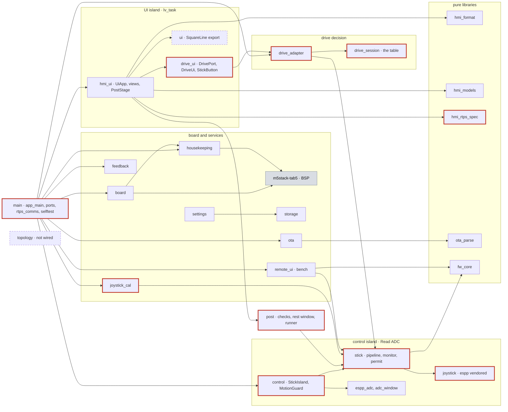
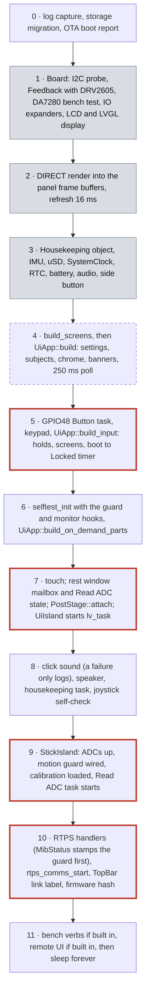
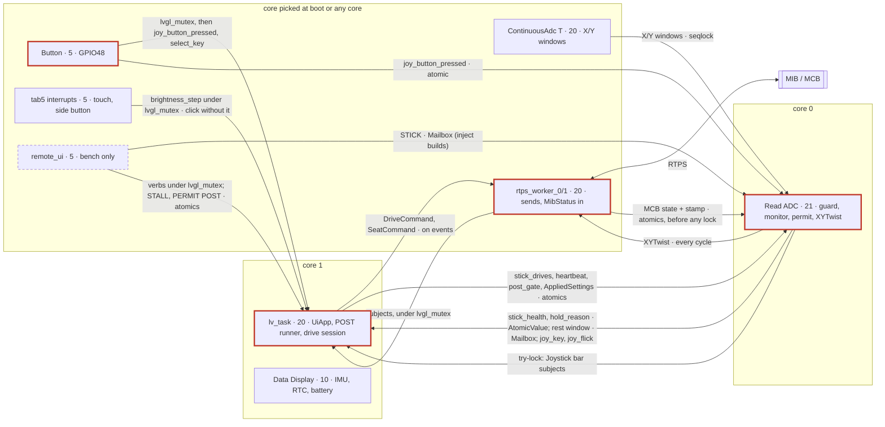
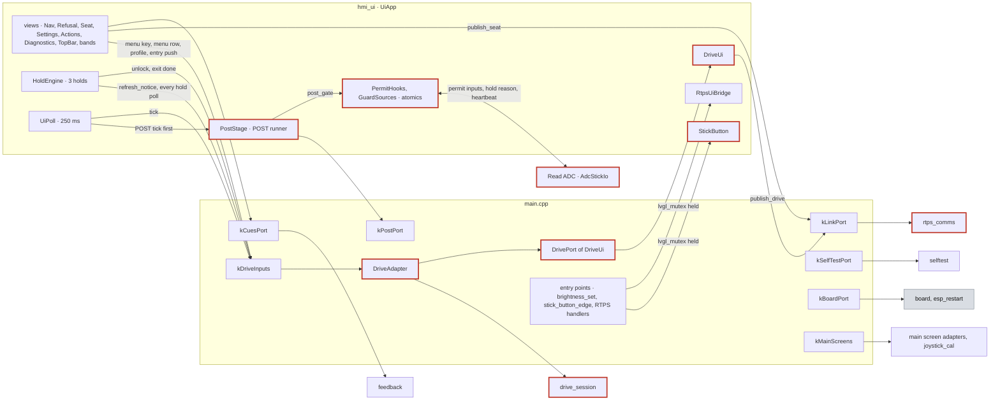
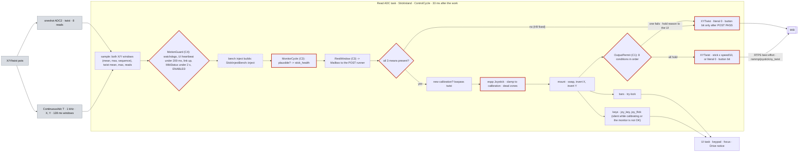
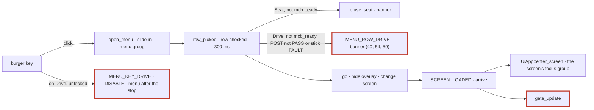
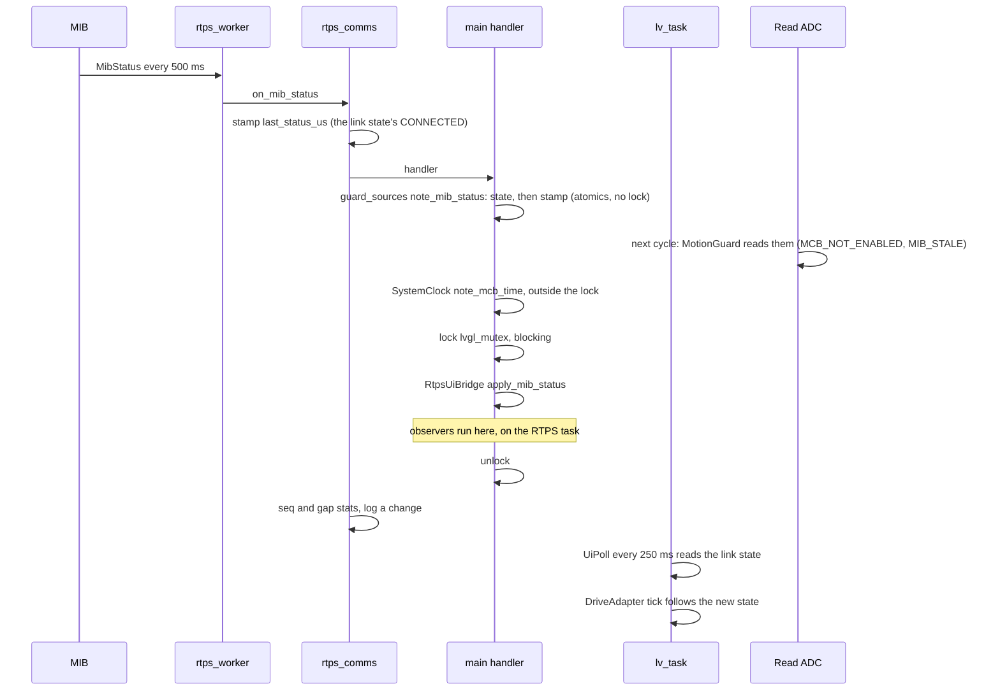

# How the firmware works

A walk through the code as it is on `dev_ai_hazard_candidate` at `46f5719` (2026-10-11):
`dev_refactor` plus the hazard fixes C1, C3, C4, C2 and C2b and the two priority changes (the
RTPS workers and the ContinuousAdc task at priority 20). What runs, in which order, on which
task, and how the pieces talk. It is a map for reading the code, not a design.

**Start with the two one-page overviews:** [fw-overview.md](fw-overview.md) (every task and
every channel in one diagram) and [testing-overview.md](testing-overview.md) (every test and
gate in one diagram). This page is the detail behind them. The user's view of the screens is in
[ui-architecture.md](ui-architecture.md), the generated diagrams (D2 target islands, D3
component dependencies) are in [architecture.md](architecture.md), and the target design is in
[plans/refactor.md](plans/refactor.md). Line numbers are for `46f5719`. They drift, but the
function names don't, so search for the name if a line has moved.

Where the code does not say something clearly, this page says "unclear from the code" rather
than guess.

Diagram legend: the same as [architecture.md](architecture.md#legend-cs-arc-03). Grey is
hardware, a red outline is safety-relevant, and a dashed outline is generated code or code that
is built but not wired.

## Contents

1. [The short version](#1-the-short-version)
2. [How the source is laid out](#2-how-the-source-is-laid-out)
3. [Boot: `app_main` step by step](#3-boot-app_main-step-by-step)
4. [Tasks, cores and how they share data](#4-tasks-cores-and-how-they-share-data)
5. [Inside the UI task](#5-inside-the-ui-task)
6. [From stick deflection to motion](#6-from-stick-deflection-to-motion)
7. [The drive session](#7-the-drive-session)
8. [Holds, refusals and actions](#8-holds-refusals-and-actions)
9. [The seat](#9-the-seat)
10. [Screens, navigation and data binding](#10-screens-navigation-and-data-binding)
11. [RTPS and the network](#11-rtps-and-the-network)
12. [Settings, storage, OTA, self test, remote UI, log, cues](#12-settings-storage-ota-self-test-remote-ui-log-cues)
13. [Where the old fragments went](#13-where-the-old-fragments-went)
14. [Tools and tests](#14-tools-and-tests)
15. [Where the hazards live](#15-where-the-hazards-live)
16. [The hazard fixes in this code](#16-the-hazard-fixes-in-this-code)
17. [Known oddities](#17-known-oddities)
18. [Where to start reading](#18-where-to-start-reading)

## 1. The short version

- **`main` wires, components do the work.** `main/main.cpp` (1426 lines, `app_main` about 220
  code lines) builds each component from a `Config`, fills the ports the components call out
  through, and starts the tasks. The logic lives in `components/*`.
- **Three tasks matter for the user:**
  - **Read ADC** (`control`'s `StickIsland`, priority 21, core 0, 6 KB, waits 33 ms after each
    cycle): reads the stick, runs C4's **motion guard** (UI heartbeat, link, MibStatus age, MCB
    state, watchdog subscriptions), C2's **stick monitor**, C3's POST rest window, the
    `StickPipeline`, then C1's **output permit**, publishes `XYTwist` every cycle (the stick, or
    a literal 0), and resets the task watchdog.
  - **UI task** (`lv_task`, priority 20, core 1, every 8 ms): `hmi_ui`'s `UiIsland` runs
    `lv_task_handler()` under the one global `lvgl_mutex`. Every screen, timer and button press,
    the **POST runner** and the **drive session** run here. It stamps a heartbeat after every
    cycle.
  - **RTPS workers** (espp's `rtps_worker_0/1`, raised to priority 20): send every publish and
    run every subscriber callback. The MibStatus handler stores the MCB state and its stamp for
    the motion guard first, then writes LVGL subjects under `lvgl_mutex`.
- **One output permit decides whether the stick drives.** Every cycle the ADC task checks eight
  conditions in order (the gate `stick_drives`, the motion guard, no calibration run, a
  measured calibration, POST PASS, stick health not FAULT, stick health OK, the stick centred
  for 300 ms since the last hold). Anything else sends `(0, 0, 0)` and names a hold reason the
  Drive screen shows.
- **The drive session is a table.** `drive_session` decides (59 rows, pure C++).
  `drive_adapter` samples the inputs, keeps the deadlines and the stop re-send, and performs the
  actions. `drive_ui`'s `DrivePort` turns each action into its LVGL or RTPS call.
- **The MCB decides driving; the HMI follows and asks** (decision M1). The Drive screen opens
  whenever MibStatus says ENABLED on a fresh link (rows 1-2), but the stick waits for POST,
  calibration, stick health and a centred stick. It closes when the MCB stops (rows 3-9), with
  one DISABLE. The user's stop sends DISABLE and re-sends it every 250 ms until the MCB stops
  (rows 46-49); while the MCB stays ENABLED the stick still drives (G4, owner-accepted).
- **Tasks share data through atomics, `fw_core` channels and LVGL subjects.** The permit's
  inputs are `fw::AtomicValue`s (`PermitHooks`); the POST's rest windows go through a
  `fw::Mailbox`; the guard reads stamps and flags (`GuardSources`); only `lvgl_mutex` makes a
  task wait for another, and the ADC task only ever tries it. The whole map, channel by channel,
  is [fw-overview.md §2](fw-overview.md#2-the-channels).
- **The UI reaches the rest through ports.** `hmi_ui`'s `UiApp` owns every view and gets
  everything else through seven tables of plain functions (`hmi_ui/app_ports.hpp`,
  `post_stage.hpp`) that `main` fills once: `LinkPort`, `DriveInputs`, `CuesPort`,
  `SelfTestPort`, `BoardPort`, `MainScreens`, `PostPort`.
- **Built, not wired:** `topology` (the target task and channel map, D2). Everything else is in
  the image.

## 2. How the source is laid out

### 2.1 Components

"Safety" follows the red outlines in [architecture.md D3](architecture.md#d3-components) (the
Safety column of [project-profile.md](project-profile.md)). "Host" means a host L1 test app in
`tests/manifest.d`; [testing-overview.md](testing-overview.md) has them all.

| Path | What it is | Safety | Tests |
| --- | --- | --- | --- |
| `main/` | `app_main` and the wiring; the network and RTPS (`rtps_comms`); the self test; the log capture; main's side of four screens; the calibration adapter (see [§2.3](#23-what-stays-in-main)) | yes | bench B0-B5e, hazard steps |
| `components/drive_session` | The drive session: the 59-row table (`drive_session_table.hpp`, read as `TABLE.md`) and `DriveSession`, the hand-written transition function checked against it; `TABLE_FINGERPRINT` pins the data | yes | host: DSO table self-check, oracle, oracle by input (CI), full oracle (on demand), mutants, equivalence |
| `components/drive_adapter` | `DriveAdapter<Port>`: samples link, MIB state, screen, menu, calibration, hold reason, POST gate and stick fault; keeps the deadlines and the stop re-send; performs the session's actions through a port; publishes its phase and notice for other tasks | yes | host: DAD-L1; `tests/host/drive_golden` (GLD) |
| `components/drive_ui` | `DrivePort<DriveUi>` (the LVGL and DriveCommand calls), `DriveUi` (padlock, unlock advance, the stick gate's writer), `StickButton` (GPIO48 edges); also the vocabulary hmi_ui shares (`Fn`, `LinkState`, `Refused`, `SharedSubjects`) | yes | drive goldens; bench B4, B5, B5'' |
| `components/stick` | `StickPipeline`: raw mV in, the keypad key and the `XYTwist` command out; `StickMonitor`/`MonitorCycle` (C2's stick fault state machine); `OutputPermit` (C1); `PermitHooks` (the permit's three channels); `ButtonEdges`; the bench injection's parser (`bench_inject.hpp`) | yes | host: L1-STK |
| `components/control` | `StickIsland`: the "Read ADC" task, the continuous ADC's windows (X/Y) and the twist's oneshot ADC; `ControlCycle` (one cycle: guard, stick, note, watchdog reset); `MotionGuard` (C4); `BenchStall` | yes | host: L1-CTL |
| `components/espp_adc`, `components/adc_window` | espp's ADC component, vendored, with hook lines; the lock-free window snapshot (mean, max, sequence) C2 reads | not in the profile (both feed the stick) | through L1-STK, L1-CTL |
| `components/post` | The quick POST: the check table (19 checks, latched or live), the evaluator, the rest window (fed by Read ADC) and `PostRunner` (run by `hmi_ui`'s `PostStage` on the UI task) | yes | host: L1-POST |
| `components/joystick_cal` | The calibration record, its file format and `check()`, and the calibration run as a pure model | yes | host: L1-CAL |
| `components/joystick` | espp's joystick, vendored, plus a twist (Z) axis | yes | host: L1-JOY |
| `components/hmi_rtps_spec` | What only this HMI adds to the RTPS spec: HMI topics, timeouts, seat unit helpers, banner and notice texts, self-test tags | in part | host: L1-RTPS |
| `components/hmi_ui` | The UI island: `UiApp` and every view, `UiIsland` (the UI task), `UiPoll` (the 250 ms tick), `PostStage` (the POST runner), `NavView`, `RefusalView`, `DriveNoticeView`, `HoldEngine`, `DisplayFlip`, `app_state` (the shared atomics) | no | bench B4 |
| `components/board` | `Board`: the Tab5 bring-up on the BSP in `app_main`'s order; the touch and side-button adapters; `backlight`, `present` | no | bench |
| `espp/m5stack-tab5` | espp's Tab5 BSP (third party; two frame buffers and the vsync present from its Kconfig and API) | no | none |
| `components/housekeeping` | `Housekeeping` (the "Data Display Task": IMU, battery, RTC every 20 ms) and `SystemClock` (keeps the clock and RTC to the MIB's time) | no | bench |
| `components/feedback` | `Feedback`: the DRV2605 haptics and the click sound; the DA7280 bench test | no | bench |
| `components/settings` | User settings from one typed table, `/storage/settings.txt`; `AppliedSettings` (the atomics other tasks read) | feeds the stick | host: L1-SET |
| `components/storage` | LittleFS at `/storage`, atomic write, one-time legacy migration | no | bench B2 |
| `components/ota` | `fw_info` (SHA-256 of the running image, matched to a release) and `github_ota` (release list, install, boot confirm) | no | bench B2, B4 |
| `components/ota_parse` | Pure OTA parsing: release JSON, image header, fwinfo lines, the boot-confirm marker | no | host: L1-OTA |
| `components/remote_ui` | Bench-only TCP 3333 debug server; the hazard bench verbs (`bench_verbs.hpp`); the stick injection slot (`stick_inject.hpp`) | bench only | host: L1-RUI (verbs); bench |
| `components/hmi_format` | Pure text formatting (speed, steppers, clock, diagnostics, about, update, network) | no | host: L1-FMT |
| `components/hmi_models` | Pure UI models: the grid cursor walk, the bench PIN | no | host: L1-MOD |
| `components/fw_core` | Channels (`Mailbox`, `Queue`, `AtomicValue`), `ThreadChecker`, `Owned<T>`, `check()`. `Mailbox` and `AtomicValue` are in the image (the permit hooks, the POST rest windows, the bench injection); `Queue` is not used yet | used by safety | host: FWC-L1 |
| `components/topology` | The target task and channel map (feeds D2). **Not wired** | n/a | host: TOP-L1 |
| `components/ui` | The SquareLine Studio export. **Generated**; never edit it | no | `scripts/ui_contract.py` |
| `external/rammp-rtps` | Submodule: the RTPS topics and messages shared with the MIB/MCB | yes (wire format) | header-only |

### 2.2 Component map

Who uses whom, simplified to the links that matter for reading the code. The exact `REQUIRES`
graph is D3 in [architecture.md](architecture.md#d3-components).



What this means in practice:

- **Each component sees only what it requires.** A component sees only what its `REQUIRES`
  gives it, and its private `src/` is closed to others (an L0 check).
- **Templates keep the hot paths in one unit.** `StickIsland`, `ControlCycle`,
  `StickPipeline::cycle`, `OutputPermit`, `MotionGuard`, `DriveAdapter` and `DrivePort` are
  templates or header-only, instantiated in `main.cpp`. So the ADC path and the drive path are
  direct calls, and the ADC task's stack is measured (POST `stk.adc`, self test `mem.stk_adc`).
- **Shared state is partly global.** `hmi_ui/app_state.cpp` holds the atomics and subjects the
  old `frag_state.inc` held (`stick_drives`, `joy_key`, `joy_button_pressed`, ...), waiting for
  their owners (app-main-shrink S7, T-H4a). The hazard fixes' channels are owned:
  `PermitHooks`, `GuardSources`, `GuardTelemetry`, `MonitorTelemetry` and `BenchStall` are
  `UiApp` members, the rest window mailbox and the ADC task's state are `app_main` locals.

### 2.3 What stays in `main/`

These are approved deviations from "main only wires" (CS-LAY-01).

| File | Job |
| --- | --- |
| `main.cpp` | `app_main`; the port tables (`kLinkPort`, `kDriveInputs`, `kCuesPort`, `kSelfTestPort`, `kBoardPort`, `kMainScreens`, `kPostPort`); the one `UiApp`, `DrivePort` and `DriveAdapter`; `AdcStickIo` (what one stick cycle reads and writes: the permit, the monitor step, the rest window, the publish) and `StickPorts` (the ADC clock, the watchdog, the bench STALL); the bench verb hooks; the entry points other tasks call under `lvgl_mutex` (`brightness_set`, `brightness_step`, `stick_button_edge`, `lvgl_cycle`) |
| `rtps_comms.cpp/.hpp` | The network link (W5500 Ethernet, or Wi-Fi via the C6) and the one RTPS participant: every publisher and subscriber, the link state and flags, the RTPS workers' priority |
| `selftest.cpp/.hpp`, `selftest_spec.hpp`, `selftest_platform.cpp/.hpp`, `selftest_names.cpp/.hpp` | The extended self test: 60 checks, an overlay, a report over RTPS and serial; the board probes it reads |
| `joystick_cal.cpp/.hpp` | The calibration's adapter: the file I/O, the LVGL view of the run, the hand-off to the ADC task |
| `about_ui`, `internet_ui`, `update_ui`, `log_view` | Main's side of four screens whose views are in `hmi_ui`: worker threads, network and OTA calls, the hand-back to the UI task, the restarts |
| `log_capture.cpp/.hpp` | Tees stdout and stderr into a 500-line PSRAM ring for the Log screen |
| `lv_mem_psram.c` | LVGL's allocator: every LVGL allocation goes to PSRAM, leaving internal DMA RAM for the W5500 |
| `boot_logo.c/.h`, `click.wav` | The boot logo mask and the click sound, embedded |
| `Kconfig.projbuild` | Build options: `HMI_REMOTE_UI`, `HMI_BENCH_STICK_INJECT`, `HMI_WIFI_SSID/PASSWORD`, `HMI_OTA_TEST_URL`, `HMI_BENCH_DA7280_TEST`, `HMI_DEBUG_FPS(_STRESS)`, and the hidden `_AS_INT` mirrors (`HMI_BOOTLOADER_SKIPS_VALIDATE_AS_INT` among them) |

## 3. Boot: `app_main` step by step

`app_main` (`main.cpp:1030-1406`) runs on IDF's `main` task (priority 1, core 0). The board
steps are `hmi::board::Board` methods; the UI steps are `UiApp` methods.



| Phase | Lines | What happens | Notes |
| --- | --- | --- | --- |
| 0 | `main.cpp:1033-1039` | `log_capture_start` first, so the Log screen sees everything. `storage_migrate_legacy`, `github_ota_boot_report` | |
| 1 | `:1041-1069` | `Board` built. `probe_internal_i2c` (0x08..0x77; the found set later goes to POST's I2C check). `Feedback` built: its constructor brings up the DRV2605; `feedback` points at it. `run_da7280_bench` (no-op unless `HMI_BENCH_DA7280_TEST`). `start_io_expanders`, `start_display` (LCD, full-screen PSRAM draw buffers) | either failure stops the boot (`park_main_task`): no UI ever |
| 2 | `:1078-1089` | `start_direct_render`: LVGL renders straight into the two DSI frame buffers (`DisplayFlip::use_panel_buffers`); a flush is a vsync swap. Refresh timer 16 ms. FPS meter only with `HMI_DEBUG_FPS` | if the buffers are missing, the BSP's flush stays; the self test reports it |
| 3 | `:1093-1118` | `Housekeeping` built (the Kalman filter the IMU needs). `start_imu`, `start_sdcard` (only warns), `SystemClock` built, `start_rtc` (sets the clock if the RTC time is plausible), `start_battery`, `start_audio`, `start_side_button` | IMU, RTC, battery or audio failure stops the boot (`park_main_task`). **The side-button task is live from here** and its press takes `lvgl_mutex` |
| 4 | `:1125-1129` | `build_screens`: rotation 0, `ui_init()` builds all 14 screens, BenchMotors, Settings, SkunkWorks and Diagnostics are destroyed again, the boot logo is swapped for an A8 mask. `UiApp::build`: settings load and theme, brightness, every Settings subject, the Joystick bars, the MCB/link/band subjects, every resident screen's chrome, the banners, **the 250 ms poll timer**, the calibration view | subjects are initialised before anything binds to them |
| 5 | `:1136-1157` | **GPIO48 `Button` task starts** (its callback takes `lvgl_mutex`). `KeypadInput` for the stick. `UiApp::build_input`: nav groups and the 500 ms backstop, the padlock and the three holds (**33 ms hold poll**, which also refreshes the Drive notice), Log/Seat/Internet/About, Update (its **30 s OTA confirm** one-shot), seat values and screen-loaded hooks, `finish_build` (perf overlay hidden, overdraw pass, **1.2 s boot→Locked** one-shot) | the Button task is live while `app_main` keeps building the UI without the lock (H15) |
| 6 | `:1164-1186` | `selftest_platform` with two C4/C2 hooks (`motion_guard`: both watchdog subscriptions, the largest UI heartbeat age, UI stalls while driving; `stick_monitor`: stick health, implausible samples, the largest X/Y age), then `selftest_init` (registers the self test's RTPS handlers, so before RTPS starts). `build_on_demand_parts` (PIN pad, Settings, Skunk Works, Diagnostics parts that outlive their screens) | |
| 7 | `:1188-1254` | `start_touch` (BSP touch task; each press clicks). The touch input is wrapped for the flip, under the lock. The **POST rest window mailbox** and the ADC task's state (`AdcStickIo::State`: the permit, the rest window, the mailbox's write end, the monitor) are made; `ui_app.attach_stick_log`; `PostStage::attach` takes the mailbox's read end, the I2C scan and the `post` logger. **`UiIsland::start`: `lv_task` runs**, with the heartbeat and the watchdog subscription on its first cycle | from here every LVGL call must hold `lvgl_mutex`. The POST runner starts with the 250 ms poll: its 3 s budget runs from its first tick |
| 8 | `:1259-1279` | `load_audio` (click.wav): on success `start_speaker`; on failure an error line and the boot goes on silent (owner, 2026-10-11). `housekeeping.start()` (the 20 ms task). `espp::joystick_selftest()` (asserts; nothing under `NDEBUG`) | a housekeeping task that fails to start is logged (error) and the boot goes on |
| 9 | `:1291-1358` | `StickIsland` built: the continuous ADC (ADC1 CH0/CH1, 1 kHz, **its task at priority 20**) starts, then the twist's oneshot ADC (ADC2 CH3). The motion guard gets `GuardSources`, rtps_comms' link flags, `stick_drives` and `GuardTelemetry`. `joystick_cal_load` (ideal 0/1650/3300 mV if no valid file; then `joystick_cal_measured()` is false and the permit holds the stick). The monitor takes the calibration's limits. `stick_island.start`: the `StickPipeline` (or `StickInjectBench`) on that calibration, **the `Read ADC` task** | a failed start is logged (error) and the boot goes on with no `XYTwist` (no motion); POST's budget then fails with "Read ADC not running" |
| 10 | `:1366-1394` | RTPS handlers: brightness, MibStatus (**first** `note_mib_status` for the guard, then the clock outside the lock, then the subjects under it), diagnostics. `rtps_comms_start` with the network setting. TopBar link label, under the lock. `fw_info_start` (hashes the image on a low-priority thread, after the W5500 is up) | a network failure only warns |
| 11 | `:1400-1405` | In stick-inject builds `remote_ui_attach_bench_verbs` (the hazard verbs' hooks), then `remote_ui_start` (no-op unless `HMI_REMOTE_UI`), then `park_main_task()`: `sleep(1s)` for good | `app_main` never returns, so every local stays alive |

Things to keep in mind:

- **A failed step stops the boot, and `app_main` never returns.** A failure in phases 1-3, at
  touch or at the UI task's start ends in `park_main_task()`, which sleeps for good, so no UI
  ever starts. After phase 7 nothing stops the boot: a failed click sound, housekeeping task or
  Read ADC task is logged and the boot goes on.
- **Why it parks instead of returning.** From phase 3 on, the BSP's side-button task holds a
  `SideButton` that refers to `app_main`'s logger; from phase 7 the touch task calls the
  `Board`'s `TouchClick` and, through it, `feedback`; the ADC task's state and the rest window
  mailbox are `app_main` locals. The BSP has no call that stops its tasks, so a `return` would
  leave them calling destroyed locals. Parked, every local lives.
- **No motion until POST passes.** The POST gate starts NOT_RUN; the permit holds the stick and
  sends the button bit released until the runner on the UI task writes PASS (C3). A Read ADC
  task that failed to start means no `XYTwist` at all, and POST fails at its budget with the
  cause "Read ADC not running" (`stick_task_running()` reads FreeRTOS's task list).
- **The first fresh link sends one DISABLE** (rows 50-51, C3), so an MCB left ENABLED by a
  previous HMI life is asked to stop before anything else.
- **Timers count from creation.** The 250 ms poll, the 1.2 s boot→Locked and the 30 s OTA
  confirm are created in phases 4-5, before `lv_task` runs them. If phases 5-7 took more than
  1.2 s, the boot screen would leave on the first handler pass. Unclear from the code how long
  they take; the bench boot log has the times.

## 4. Tasks, cores and how they share data

### 4.1 The tasks

The values are what the source creates, checked against `tools/guards/baselines/tasks.json`
(G10). "fpu" means the task asked for no core: IDF's RISC-V port pins it to the core it was on
at its first FPU use, so it can differ from boot to boot. Priority 0 given to an espp task or
`std::thread` means IDF's pthread default, 5.

| Task | Prio | Core | Stack | Created | Runs |
| --- | --- | --- | --- | --- | --- |
| `Read ADC` | 21 | 0 | 6144 | `main.cpp:1305-1338` (`hmi::control::StickIsland`) | one `ControlCycle`: the reads, the motion guard, the monitor, the rest window, one `StickPipeline` cycle with the output permit, `XYTwist`, the task-watchdog reset; then waits 33 ms |
| `lv_task` | 20 | 1 | 16384 | `main.cpp:1217-1250` (`hmi::ui::UiIsland`) | `lvgl_cycle`: `lv_task_handler()` under `lvgl_mutex`, then the heartbeat stamp and the watchdog reset, then sleep to 8 ms after the start (at least 1 ms). All UI, all LVGL timers, the POST runner, the drive session |
| `ContinuousAdc T` | 20 | fpu | 4096 | espp (vendored `espp_adc`), built by `StickIsland`; `task_priority = 20` in main's config | ADC1 DMA at 1 kHz, X and Y; publishes each 128 ms window lock-free |
| `rtps_worker_0/1` | 20 | fpu | 6144 | espp RTPS thread pool; raised from 5 by `raise_rtps_workers` (`rtps_comms.cpp:563`) when the participant starts | every publish's send (XYTwist included) and every subscriber callback |
| `Button` | 5 | any | 4096 | `main.cpp:1136-1147` (`espp::Button`) | GPIO48 edges → `stick_button_edge` |
| `tab5 interrupts` | 5 | any | 4096 | BSP | touch reports (`TouchClick`) and the side button (`SideButton`) |
| `Data Display Task` | 10 | 1 | 6144 | `main.cpp:1093-1104` (`hmi::housekeeping::Housekeeping`) | RTC, battery and IMU every 20 ms; no LVGL, publishes nothing |
| `tab5_audio`, `… microphone` | 20 | 1 | 8192 | BSP | I2S speaker and microphone |
| `rtps_start` | 5 | fpu | 8192 | `rtps_comms.cpp:980-1015` | one-shot: Wi-Fi up if chosen, wait for an IP, ping the gateway, start the participant |
| `rtps_pub` | 5 | any | 8192 | `rtps_comms.cpp:1008-1011` | heartbeat every 2 s; rebinds RTPS when the IP changes |
| `rtps_reactor`, `rtps_protocol` | 5 | any, fpu | 6144, 4096 | espp RTPS | socket reactor; SPDP discovery |
| `remote_ui` | 5 | any | 16384 | `components/remote_ui/src/remote_ui.cpp:662` | TCP 3333 server, bench builds only |
| `selftest` | 3 | 0 | 12288 (PSRAM) | `main/selftest.cpp:1217` | on demand: one self-test run |
| `fw_hash` | 2 | any | 6144 | `components/ota/src/fw_info.cpp` | once at boot: SHA-256 of the image |
| `github_ota` | 3 | any | 12288 | `components/ota/src/github_ota.cpp` | on demand: download and install |
| `internet_ui`, `update_ui` | 5 | any | 8192, 12288 | `main/internet_ui.cpp`, `main/update_ui.cpp` (`spawn`) | on demand: Wi-Fi scan/join, release list |
| `main` | 1 | 0 | 33280 | IDF | `app_main`, then sleeps |

The rest are IDF's own (`IDLE0/1` 0, `ipc0/1` 24, `esp_timer` 22 on core 0, `sys_evt` 20 on core
0, `tcpip` 18) and esp_hosted's `sdio_*` and `rpc_*` tasks (priority 23), which carry Wi-Fi from
the C6. No free-stack figures here: POST's `stk.adc` and `stk.ui` checks and the self test's
`mem.stk_*` measure them on the board.

What this table shows:

- **The stick reader runs above everything the application has** (hazard fix C4, H11). `Read
  ADC` (21, core 0) sits above `lv_task`, the RTPS workers and the ContinuousAdc task (20), and
  checks the UI's heartbeat itself: a UI cycle 200 ms late or more sends the literal 0
  (`UI_STALE`). It sits below IDF's timing services (`esp_timer` 22, esp_hosted 23, `ipc` 24).
- **The two priority-20 changes keep the stick's data flowing past a busy UI task.** The
  ContinuousAdc task (X/Y producer) and the RTPS workers (which send XYTwist) were at 5; a
  stuck `lv_task` on their core starved them (C2's STALE fault from UI work; no XYTwist during
  a UI stall, bench B5i). At 20 they share time with `lv_task` instead. The code comments and
  `tasks.json` still say "PROPOSAL" (`hazard-c2-cadc-priority.md`, `hazard-c4-rtps-priority.md`).
- **Both safety tasks are on the task watchdog** (2 s). Phase 1: a trip only reports
  (`CONFIG_ESP_TASK_WDT_PANIC` is off; the idle-task checks are off). A task that fails to
  subscribe holds the stick (`WDT_MISSING`).
- **Core 1 is busy:** `lv_task`, the housekeeping task and the audio tasks are pinned there;
  the fpu tasks land on whichever core they first used the FPU on.

### 4.2 How they talk

Every channel, with its writer, reader and mechanism, is in
[fw-overview.md §2](fw-overview.md#2-the-channels). In short:



**Atomics and `fw_core` channels** (declared in `hmi_ui/app_state.hpp` unless named):

| Value | Kind | Written by | Read by | Meaning |
| --- | --- | --- | --- | --- |
| `stick_drives` | `std::atomic<bool>` | UI task (`DriveUi::update_stick_gate`) | Read ADC (permit condition 1; the guard's stall counter) | the gate |
| `PermitHooks::post_gate` (`stick/permit_hooks.hpp`, a `UiApp` member) | `fw::AtomicValue<PostGate>` | UI task (`PostStage`, the POST runner; its only writer) | Read ADC (permit 5, the button bit, the rest window); UI task (drive sample `POST_OK`, notice text) | NOT_RUN, PENDING, PASS, FAIL |
| `PermitHooks::stick_health` | `fw::AtomicValue<StickHealth>` | Read ADC (`MonitorCycle`, every cycle) | Read ADC (permit 6, 7); UI task (drive sample `STICK_FAULT`, TopBar indicator, Joystick screen words) | NOT_MONITORED, OK, CHECK, FAULT |
| `PermitHooks::hold_reason` | `fw::AtomicValue<HoldReason>` | Read ADC (the permit) | UI task (Drive notice, every 33 ms; drive sample) | why the stick is held |
| `RestWindowMailbox` (`hmi_ui/post_stage.hpp`, an `app_main` local) | `fw::Mailbox<RestWindowMsg>` | Read ADC, once per 30 cycles until the gate is PASS or FAIL | UI task (POST runner) | POST's stick-at-rest window |
| `GuardSources` (`control/motion_guard.hpp`, a `UiApp` member) | `StampCell` (u32 ms, release/acquire), `std::atomic` | UI task: `ui_heartbeat` after every cycle, `ui_wdt_ok` once; RTPS worker: `mcb_state` then `mcb_rx` for each MibStatus | Read ADC (motion guard) | C4's freshness inputs |
| link flags `net_failed`, `link_up`, `got_ip`; `last_status_us` (`rtps_comms.cpp`) | `std::atomic` | sys_evt (event handlers), `rtps_start`, `app_main`; RTPS worker | Read ADC (guard `LINK_DOWN`); UI task (`rtps_comms_link_state`) | the link |
| `GuardTelemetry`, `MonitorTelemetry` (`UiApp` members) | relaxed atomics | Read ADC | UI task (the stick log), self test, remote UI STATE | observability only |
| `applied_settings` (`settings_applied.hpp`): sensitivity, drive speed, invert X/Y, swap, sounds | atomics | UI task (`UiApp::store_setting` → `AppliedSettings::apply`) | Read ADC, the click sound | settings other tasks need without the lock |
| `joy_key`, `joy_flick` | `std::atomic<uint32_t>` | Read ADC; remote UI (`joy_key`) | UI keypad read (`UiApp::keypad_read`) | the stick as arrow keys |
| `select_key` | `std::atomic<bool>` | `StickButton::edge`, remote UI | UI keypad read | a short button tap = ENTER |
| `remote_key` | `std::atomic<uint32_t>` | remote UI | Read ADC | overrides the stick's key |
| `joy_button_pressed` | `std::atomic<bool>` | `StickButton::edge` (Button task, remote UI) | Read ADC (the `XYTwist` button bit, the rest window), the holds | raw button level |
| `drive_profile_published` | `std::atomic` | UI task (profile tap) and the profile subject's observer (so also the RTPS worker) | `DrivePort::publish` | profile sent with each DriveCommand |
| `clock_valid` (`main.cpp:398`) | `std::atomic<bool>` | `SystemClock` (boot, RTPS worker) | TopBar | the clock holds a real time |
| drive mirrors: `DriveAdapter::phase_pub_`, `notice_pub_`, `stop_pub_`; `DriveUi::menu_open_pub_`; `UiApp::refused_pub_` | `std::atomic` | UI task | remote UI STATE | the drive session for other tasks |
| `BenchStall` (`control/bench_stall.hpp`, a `UiApp` member) | `std::atomic<uint32_t>` ×3 | remote UI (STALL) | UI task, Read ADC (each takes its own) | bench builds only |
| `StickInjectMailbox`, `StickInjectActive` (`remote_ui/include/stick_inject.hpp`) | `fw::Mailbox<StickInjectMsg>`, `fw::AtomicValue<bool>` | remote UI (STICK); Read ADC | Read ADC; the remote UI's marker on the UI task | stick-inject builds only |

**`lvgl_mutex`** (`main.cpp:77`) is one `std::recursive_mutex`. It exists because
`lv_subject_set_*` runs every observer at once, on the caller's task, and observers touch
widgets. No view takes it: `hmi_ui`'s rule is that main's entry points take it for them
(CS-OWN-08). Who takes it:

- **UI task:** around every `lv_task_handler()` (`lvgl_cycle`). That covers every timer,
  event, observer, input read and flush, the POST runner and the drive session. A flush can
  wait for vsync, about 17 ms.
- **RTPS worker:** the MibStatus and diagnostics handlers (`main.cpp:1371-1382`) and
  `brightness_set`, blocking. The MibStatus handler writes the guard's state and stamp *before*
  it takes the lock, so the stick task sees a stopped MCB even while the UI task holds the lock.
- **Read ADC:** `AdcStickIo::show` uses **try-lock** for the three bar subjects. It skips the
  update when the lock is busy and never blocks. Nothing else on the stick path takes it.
- **Button task, side button, remote UI, self test, the Internet and Update workers (for
  `lv_async_call`):** blocking.
- **`app_main`:** only around `wrap_touch` and the TopBar link label. It builds the UI without
  the lock. That was safe only while no other task touched LVGL, but the side-button and
  GPIO48 tasks already run by then (H15).

## 5. Inside the UI task

### 5.1 The loop and its timers

`UiIsland` (`components/hmi_ui/src/ui_island.cpp`) loops: run `lvgl_cycle`, then wait until
`start + 8 ms`, but at least 1 ms, so a slow cycle still yields to `IDLE1`. It uses
`steady_clock`, because the MIB sets the wall clock. After each cycle it stamps the motion
guard's UI heartbeat (on the ADC side's ms clock) and resets the task watchdog; on its first
cycle it subscribes to the watchdog (C4). Everything below runs inside `lv_task_handler()`, on
this task, with the lock held.

| What | Period | Created in | Does |
| --- | --- | --- | --- |
| Display refresh + flush | 16 ms | `main.cpp:1084` | renders dirty areas; `DisplayFlip`'s flush presents on vsync (or turns the frame 180° with the PPA when flipped) |
| Hold poll | 33 ms | `UiApp::init_lock_screen` | `RefusalView::poll` (the ENTRY_PUSH check), then the three holds, then the Drive notice from the stick's hold reason (`DriveInputs::refresh_notice`) |
| `UiPoll::poll` | 250 ms | `UiApp::bind_banners` | link state → `rtps_link` subject, blink, `DiagnosticsView::poll`, **the POST tick** (`PostStage::tick`: a bench request, the runner on a new rest window, the indicator state), **the drive tick** (`DriveAdapter::tick`), the POST indicator (TopBar), theme check |
| Nav backstop | 500 ms | `NavView::start_input` | re-enters the screen if the stick's group lost focus twice in a row |
| TopBar clock | 1 s | `TopBarView::start_clock` | the clock text |
| Brightness save | 1 s after the last change | `BrightnessView` | writes the setting once it settles |
| Refusal dwell | 2–3 s, set per raise | `RefusalView::start_timer` | takes a banner down |
| Unlock advance | one-shot 1 s | `DriveUi::unlock_timer_start` | hands the session UNLOCK_TIMER (fade to Drive) |
| Row press | one-shot 300 ms | `NavView::row_picked` | the picked row's flash, then `NavView::go` |
| OTA confirm | one-shot 30 s | `main.cpp:729` (`update_screen_init`) | `github_ota_boot_confirm` |
| Boot → Locked | one-shot 1.2 s | `hmi_ui/src/ui_build.cpp:78` | fades from the boot logo to Locked |
| Calibration run | 33 ms, paused when idle | `main/joystick_cal.cpp:295` | steps the calibration model |
| Drive notice refresh | 250 ms | `DriveNoticeView` | re-reads the POST reason while the notice shows it (the gate is an atomic, not a subject) |
| Log, About, Internet, Update pollers | 250 ms, 1 s, 500 ms, 250 ms | their views or adapters | refresh while their screen is up |
| Input reads | each handler pass | | keypad (`UiApp::keypad_read`), touch (flip-aware), remote UI pointer |

**The drive session and the POST runner tick every 250 ms, POST first.** A POST pass seen on a
tick is used by that tick's drive step. Every drive deadline (750 ms answer, 2 s give-up,
750 ms exit, 250 ms stop re-send, 5 s "MCB did not stop") is therefore rounded to the tick.
`ui_app.cpp` `static_assert`s that the poll period is the table's `kTickPeriod`.

**The POST runner is safety logic on the UI task** (decision C6, a declared deviation from
CS-SAF-04 until the islands work moves it to `control`). A stalled UI task leaves the gate
PENDING or NOT_RUN, which holds the stick; the motion guard's heartbeat check holds it too.

### 5.2 How the UI is wired: `UiApp` and its ports

`UiApp` (`hmi_ui/ui_app.hpp`) is one `constinit` object at `main.cpp:586`. Its members are
every view, in dependency order, each with a `Config` of pointers and `Fn` callables
(`drive_ui/fn.hpp`: a function pointer or a member function bound to its object, with no
allocation). What the UI needs from outside comes through seven ports that `main` fills once as
`constexpr` tables. It also owns the hazard fixes' cross-task channels (`PermitHooks`,
`GuardSources`, `GuardTelemetry`, `MonitorTelemetry`, `BenchStall`) and the POST runner
(`PostStage`), so other tasks reach them through `ui_app` without the lock.



| Port | Filled in `main.cpp` with | Used for |
| --- | --- | --- |
| `LinkPort` `:422` | `rtps_comms_link_state`, `log_link_change`, `rtps_comms_net_link`, the network setting's text, `rtps_comms_diag_stats`, `rtps_comms_publish_drive`, `rtps_comms_publish_seat` | the link subject, the TopBar, diagnostics staleness, both commands |
| `DriveInputs` `:440` | `drive_adapter.input`, `.tick`, `.unlock_hold_done`, `.exit_hold_done`, `.refresh_notice` | every drive session input; the Drive notice between ticks |
| `CuesPort` `:448` | `play_click`, `play_refusal`, `refusal_feedback`, two DRV2605 waveforms | clicks, refusals, the haptic test |
| `SelfTestPort` `:457` | `selftest_ui_visible`, `selftest_ui_dismiss`, `selftest_request(LOCAL)` | the overlay owning the stick; the tile |
| `BoardPort` `:463` | `hmi::board::backlight`, `hmi::board::present`, `action_restart_hmi` | backlight, the flush's swap, the Restart tile |
| `MainScreens` `:469` | `log_*`, `internet_*`, `about_*`, `update_*`, `calibration_*` | the screens whose adapters stay in `main` |
| `PostPort` `:574` | the ms clock, `esp_reset_reason`, the OTA image state, the calibration, heap and stack headroom (`Read ADC`, `lv_task`), calibration saved, `stick_task_running` | the POST runner's facts (`static_assert`s pin the IDF enums, POST-050) |

There is one loop in this wiring, on purpose: `UiApp` owns the `DriveUi`; `main` makes the
`DrivePort` and the `DriveAdapter` over `ui_app.drive_ui()`; and `UiApp` calls the adapter
back through `DriveInputs`. The adapter drops (and logs) an input that arrives while another is
being performed (REQ-DAD-03), so a port method cannot re-enter it.

## 6. From stick deflection to motion



Five files carry this path: `components/control/include/control/stick_island.hpp` (the task
and the reads), `control/cycle.hpp` (`ControlCycle`: guard, stick, note, watchdog, in that
order), `control/motion_guard.hpp`, `components/stick/include/stick/stick_pipeline.hpp` (one
cycle, `cycle<Io>`) with `output_permit.hpp` and `monitor_cycle.hpp`, and `main.cpp:233-355`
plus `:618-671` (`AdcStickIo`, everything the cycle reads and writes outside itself).

| Step | Code | Detail |
| --- | --- | --- |
| Read | `StickIsland::read_windows`, `read_twist` | X = ADC1 CH1 (GPIO17) and Y = ADC1 CH0 (GPIO16): both windows from one lock-free snapshot of ContinuousAdc's last 128 ms window (mean, max, a sequence that advances per window); twist = ADC2 CH3 (GPIO52), 8 oneshot reads: mean, max, how many succeeded |
| Guard | `ControlCycle::run` → `MotionGuard::evaluate` | from atomics only: `WDT_MISSING` (either task failed to subscribe), `UI_STALE` (heartbeat ≥ 200 ms or never), `LINK_DOWN` (net failed, no link or no IP), `MIB_STALE` (newest MibStatus ≥ 2000 ms or none), `MCB_NOT_ENABLED`; first that holds wins, OK otherwise. A stale stamp stays stale until it changes. The verdict goes to the Io before the stick runs |
| Inject | `StickInjectBench::inject` (bench inject builds only) | drains the STICK mailbox; while an injection holds (300 ms after the last STICK) the sample is replaced, `fail_mask` can fail a read, make a value NaN or freeze the X/Y sequences. Everything after it is the real code |
| Monitor | `AdcStickIo::note_sample` → `MonitorCycle::step` | judges the raw sample: P1 a mean missing, P2 NaN/inf, P3 negative, P4 a max above the axis's limit (calibrated max + 100 mV, at most 3150 mV), P5 X/Y sequence unchanged 300 ms, P6 fewer than 8 good twist reads. States INIT, OK, SUSPECT, RECOVERING, FAULT, CALIBRATING: 3 implausible samples in 30 cycles latch FAULT (until a recalibration or a reboot); 3 clean cycles end RECOVERING. Writes `stick_health` |
| Rest window | `AdcStickIo::note_reads` → `feed_rest_window` | until the POST gate is PASS or FAIL: every 30 cycles one `StickWindow` (valid cycles, each axis at rest, button idle) to the POST runner's mailbox; never waits. An invalid cycle also restarts the permit's neutral wait |
| Valid? | `StickPipeline::cycle` | a mean missing: `publish_neutral` sends a literal 0 (H9 fixed), the button bit only if POST passed, the key released; nothing else runs that cycle |
| New calibration | `AdcStickIo::take_new_calibration` → `joystick_cal_take_new` | a finished calibration run is applied here, between two samples; the monitor takes its limits |
| Twist filter | `AdcStickIo::smooth_twist_mv` | lowpass, τ = 80 ms |
| Map | `StickPipeline::map` (espp `Joystick`) | each axis is clamped to its calibrated min/max, so an out-of-range raw reads as full deflection (H3; C2's monitor catches the high side). Circular dead zone 0.10, range dead zone 0.05; twist dead bands 60 mV (centre) and 40 mV (ends). Y is inverted so +Y is forward |
| Mount | `hmi::stick::mount` | swap first, then invert X, invert Y, from `applied_settings` |
| Keys | `StickPipeline::update_keys` | Schmitt trigger on the larger axis; engage threshold 0.30 (sensitivity 1) down to 0.01 (10), release half of it. `remote_key` overrides. A new key also goes to `joy_flick`. Silent while calibrating or while the monitor is outside OK and RECOVERING |
| Bars | `AdcStickIo::show` | try-lock, then the three Joystick-screen subjects ×100 |
| Permit | `AdcStickIo::output_permit` → `OutputPermit::cycle` | the 8 conditions below; the first that fails is the hold reason, written to `PermitHooks::hold_reason` |
| Publish | `AdcStickIo::publish` → `rtps_comms_publish_adc` | `XYTwist{x·s, y·s, twist·s, buttons}` with s = drive speed / 10, or `(0, 0, 0)` when held: a literal, never a multiply, so no NaN or -0.0 gets through. The button bit is sent released until POST passes. Returns false until the endpoints exist and a peer has matched |
| Note | `AdcStickIo::note_cycle` → `selftest_note_adc` | every cycle, valid or not, for the self test's cadence and failure counts |
| Watchdog | `StickPorts::watchdog_reset` | `esp_task_wdt_reset`; then (bench builds) STALL ADC and STALL CADC |

**The output permit** (`stick/output_permit.hpp`, hazard fix C1 §3) is the one gate between the
stick and `XYTwist` for C1, C3, C4 and C2. Every valid cycle, in this order:

| # | Condition | Source | Hold reason |
| --- | --- | --- | --- |
| 1 | the gate `stick_drives` is open | UI task, `DriveUi::update_stick_gate` | GATE_SHUT |
| 2 | the motion guard says OK | this cycle's `MotionGuard` verdict | MOTION_GUARD |
| 3 | no calibration run | `joystick_cal_running()`, read once per cycle | CALIBRATING |
| 4 | a measured calibration is in use (G5) | `joystick_cal_measured()`: false on the ideal defaults or after `CAL UNSAVED` | NOT_CALIBRATED |
| 5 | the POST gate is PASS (G3) | `PermitHooks::post_gate` | POST_NOT_PASSED |
| 6 | stick health is not FAULT | `PermitHooks::stick_health` | STICK_FAULT |
| 7 | stick health is OK (CHECK, NOT_MONITORED or any other byte holds) | same | STICK_CHECK |
| 8 | the neutral latch is set (G1): every valid cycle for 300 ms read exactly 0 after mapping | the permit's own state | CENTRE_FIRST |

Any of 1-7 failing clears the latch, so every change from held to allowed needs the stick
centred first. Once set, the latch stays while 1-7 hold, whatever the stick does. The Drive
screen's notice shows the hold reason (after the user's stop notice, if one is up).

**The gate** is written in one place, `DriveUi::update_stick_gate` (`drive_ui.cpp:124`):

```cpp
stick_drives = drive_session::stick_drives(locked, drive_screen_of(lv_screen_active()), menu_open);
// = !locked && screen == DRIVE && !menu_open   (drive_session_table.hpp:977)
```

It is recomputed only at the session's GATE_UPDATE action (every lock and unlock) and at
`NavView`'s four triggers: `close_menu`, `open_menu`, `go`, and `arrive` (every
SCREEN_LOADED). The gate itself has no age, but the ADC task no longer trusts it alone: the
motion guard checks the UI is alive, the link is up and the MCB said ENABLED within 2 s (H4
closed by C4). The self-test overlay is not a trigger (H7).

**The same deflection does two jobs.** Every cycle it is both a motion command (`XYTwist`,
through the permit) and a navigation key (`joy_key`, silent only while calibrating or with the
monitor not OK). On the Drive screen the focus group holds only the burger key, so the arrows
do nothing there.

**The stick button** (`main.cpp:766-776` → `StickButton::edge`, on the `Button` task):

1. `stick_button_edge` takes `lvgl_mutex`, blocking. So the `XYTwist` button bit waits up to
   one render (H14).
2. Sets the Joystick screen's pressed subject, then stores `joy_button_pressed`.
3. `hmi::stick::ButtonEdges` decides the rest: a release within 500 ms of the press sets
   `select_key` (a tap = ENTER); a press more than 30 ms after the last counted one adds to
   the counter.

The holds read the raw level. Their 500 ms grace equals the tap limit (`static_assert` in
`ui_app.cpp`), so a tap never starts a hold fill and a hold never selects.

**Calibration** (`components/joystick_cal` + `main/joystick_cal.cpp`):

- **File:** `/storage/joystick_cal.txt`, `version 1`, then min, centre and max in mV per axis.
- **Load:** once at boot (`main.cpp:1348`). A record is used only if `hmi::cal::check()` finds
  nothing: every number finite, min ≥ 0, at least 1000 mV each way from rest, and max ≤ 3050 mV
  (C2's upper bound). Otherwise the ideal 0/1650/3300 is used, which is not a measured
  calibration: the permit holds the stick (NOT_CALIBRATED) and POST's `joy.cal_saved` fails.
- **Run:** a 1.5 s hold of the stick button (or a finger on CALIBRATE) on the Joystick screen
  toggles it. The model steps on a 33 ms LVGL timer: rest, each direction, release; each step
  times out after 600 periods. While it runs the permit holds the stick (CALIBRATING), the keys
  are off and the monitor sits in CALIBRATING. The result must pass `check()`; it is handed to
  the ADC task once, through a mutex-guarded `pending` copy, and saved. A valid new calibration
  clears a latched stick FAULT.

## 7. The drive session

### 7.1 Three layers

| Layer | Where | Job |
| --- | --- | --- |
| Decide | `components/drive_session` (`DriveSession::step`) | phase + 7 hidden bits; one input and a sampled `Env` in, the table's actions out, in order. Pure C++, no clock, no allocation |
| Sample and act | `components/drive_adapter` (`DriveAdapter<Port>`) | reads the clock and the port's `sample()` (link live, MIB state, screen, menu, calibration, hold reason, POST gate, stick fault) into an `Env`; keeps the deadlines (`wait_warn`, `wait_until`, `exit_until`), the stop's timers (first DISABLE, last DISABLE) and the request; performs each action; counts failed publishes; publishes its phase and notice for other tasks |
| Draw and send | `components/drive_ui` (`DrivePort<DriveUi>`, `DriveUi`) | each action as its LVGL call or `rtps_comms_publish_drive` |

All of it runs on the UI task with `lvgl_mutex` held. Inputs reach the adapter through
`kDriveInputs`:

| Input | From |
| --- | --- |
| TICK (eight sub-steps) | `UiPoll::poll` every 250 ms → `DriveAdapter::tick`, after the POST tick |
| UNLOCK_HOLD_DONE | the unlock hold completing (`HoldGesture::completed`) |
| EXIT_HOLD_DONE | the drive exit hold completing |
| MENU_KEY_DRIVE | the burger key on Drive while unlocked (`NavView::key_cb` → `UiApp::nav_drive_key`) |
| PROFILE_CLICK | a drive profile button (touch only) |
| UNLOCK_TIMER | `DriveUi::unlock_advance_cb`, 1 s after an unlock |
| ENTRY_PUSH | `RefusalView::poll`: the button held ≥ 500 ms on Locked, until a refusal latches for this press |
| MENU_ROW_DRIVE | the menu's Drive row (`NavView::row_picked`) |

**One tick is two samples.** `DriveAdapter::tick` steps TICK_FOLLOW on an `Env` sampled at the
start, performs its actions, then samples once more and runs the other seven sub-steps on that
second `Env`, in `TICK_SEQUENCE`'s order: TICK_BOOT_STOP, TICK_EXIT_DUE, TICK_STOP_FAULT_DUE,
TICK_STOP_RESEND, TICK_STICK_FAULT, TICK_WARN_DUE, TICK_GIVEUP_DUE (DRV-022, DRV-116). The
refresh between two ticks (`refresh_notice`, every 33 ms hold poll) only updates the Drive
notice from the stick's hold reason; it decides nothing.

### 7.2 States

Guards used below:

- **`driving` (DOK):** link CONNECTED and MibStatus ENABLED. CONNECTED means a MibStatus
  arrived in the last 2 s, read live (not from the 250 ms link subject).
- **`mcb_ready` (RDY):** CONNECTED, and the MIB is IDLE or ENABLED.
- **POST:** the POST gate is PASS. **STK:** stick health is FAULT. **BSD:** the boot DISABLE
  went (or the user's ENABLE made it moot). **CAL:** a calibration run. **BOOT:** the Boot
  screen is up.

```mermaid
stateDiagram-v2
  [*] --> LOCKED
  LOCKED --> LOCKED : first fresh link, boot DISABLE (50)
  LOCKED --> ASKING : unlock hold done, RDY, POST, not STK, send ENABLE (18)
  LOCKED --> LOCKED : unlock hold, push or menu Drive row refused, not RDY or not POST or STK (19, 38, 40, 52-54, 57-59)
  LOCKED --> UNLOCKING : tick sees DOK, BSD, not CAL, not BOOT, asked or not (1, M1)
  ASKING --> UNLOCKING : tick sees DOK, BSD, not CAL, not BOOT (2)
  ASKING --> ASKING : 750 ms, banner not granted (15)
  ASKING --> LOCKED : tick, not DOK, warn passed, ring rests (12, 13)
  ASKING --> LOCKED : exit hold, DISABLE, the ask withdrawn (43)
  LOCKED --> LOCKED : 2 s give-up, send DISABLE (16)
  UNLOCKING --> DRIVING : 1 s timer, fade to Drive (35)
  UNLOCKING --> LOCKED : tick, not DOK, one DISABLE, banner stopped or lost (3, 4)
  DRIVING --> LOCKED : tick, not DOK, one DISABLE, banner stopped or lost (5, 6)
  UNLOCKING --> EXITING : exit hold or burger key, DISABLE, stop timer (21, 25)
  DRIVING --> EXITING : exit hold or burger key, DISABLE, stop timer (22, 26)
  UNLOCKING --> EXITING : stick FAULT, DISABLE, stop timer, STICK_FAULT banner (55)
  DRIVING --> EXITING : stick FAULT, DISABLE, stop timer, STICK_FAULT banner (56)
  EXITING --> EXITING : DISABLE every 250 ms, 1 Hz after the fault; MCB did not stop at 5 s (44, 46, 47)
  EXITING --> EXIT_REFUSED : 750 ms still DOK, banner, re-send goes on (14)
  EXIT_REFUSED --> EXIT_REFUSED : re-send and fault as in EXITING (45, 48, 49)
  EXIT_REFUSED --> EXITING : exit hold or burger key, send DISABLE (24, 28)
  EXITING --> LOCKED : tick, not DOK, one DISABLE, the stop ends, menu if the key asked (7, 8)
  EXIT_REFUSED --> LOCKED : tick, not DOK, one DISABLE, the stop ends (9)
```



The numbers are the rows of [TABLE.md §2](../components/drive_session/TABLE.md), the readable
copy of `drive_session_table.hpp` (the header wins if they differ; its D4 diagram is §5).
Self-loops left out: 10-11 (seat refusal), 17 (give-up while asking), 20, 23, 27, 29-34
(profile clicks), 36-37 (the unlock timer in an exit phase), 39, 41 (refusals while asking),
42 (an exit hold while locked: one DISABLE), 51 (the boot stop while asking).

| Phase | What it means in the code |
| --- | --- |
| LOCKED | `locked` = 1, ring at rest. The gate is shut |
| ASKING | locked, `lock_waiting`: ENABLE sent, a quarter of the ring spins |
| UNLOCKING | `locked` = 0, the 1 s advance timer armed. The gate stays shut until Drive's SCREEN_LOADED |
| DRIVING | unlocked, advance done (normally on Drive). The gate is open while the menu is shut |
| EXITING | DISABLE sent, exit deadline armed (750 ms), the stop re-sent every 250 ms. The gate stays open: the MCB decides (G4) |
| EXIT_REFUSED | deadline passed, still ENABLED. No timeout; the stick still drives while the MCB stays ENABLED; DISABLE keeps going (250 ms, then 1 Hz after "MCB did not stop" at 5 s) |

What reaches the MIB:

- **DriveCommand** goes out on SEND_ENABLE (row 18, and rows 31-32: a profile tap while
  unlocked, DOK and POST PASS, re-sends ENABLE with the new profile), on SEND_DISABLE (the boot
  stop, row 50; every relock, rows 3-9; the user's stop and its re-sends, rows 21-28, 42-43,
  46-49; the stick FAULT stop, rows 55-56; the give-up, rows 16-17; the safe state) and on
  PUBLISH_DRIVE (rows 29-30, 33-34: the request as it stands). Each send is best effort; a
  failed publish is counted and logged by the adapter, and the re-send (G4) is what makes the
  stop reliable, not an acknowledgement.
- **One DISABLE on the first fresh link after boot** (row 50), so an MCB left ENABLED by a
  previous HMI life is asked to stop.
- **XYTwist** goes out every ADC cycle: the stick when the permit allows it, a literal 0
  otherwise.

Times: hold = 500 ms grace + 1000 ms fill; unlock advance 1000 ms, then a 280 ms fade; answer
window 750 ms (one MibStatus period of 500 ms + 250 ms); give-up 2000 ms; tick 250 ms; stop
re-send 250 ms (with a 125 ms slack), "MCB did not stop" after 5000 ms, then 1000 ms. The
constants are at `drive_session_table.hpp:87-117`, pinned to the RTPS spec by `static_assert`s
in `hmi_ui/src/ui_app.cpp`.

**A corrupted state goes safe.** A phase or input outside its enum makes `step` return false
with `SAFE_STATE_ACTIONS` (DISABLE, everything cleared, ring at rest, Locked screen, gate
updated, the stop fault cleared); the adapter performs them and logs it.

**Nothing sits outside the table any more.** The exit hold completing while locked (the old
U3) is rows 42-43 (C1).

**The Drive notice** (`DriveNoticeView`, C1 §2.7) is separate from the refusal banner. It shows
the user's stop first (STOPPING, or MCB_DID_NOT_STOP once the stop fault is raised), else the
stick's hold reason (MOTION_GUARD, NOT_CALIBRATED, POST_NOT_PASSED with the POST's own words,
STICK_FAULT, STICK_CHECK, CENTRE_FIRST); GATE_SHUT and CALIBRATING show nothing there.

## 8. Holds, refusals and actions

**Holds** (`hmi_ui/hold_gesture.hpp`, `HoldEngine`):

- **The type.** A `HoldGesture` is `{progress subject, armed flag, is_held(), applies(),
  completed(), grace_ms}`. The 33 ms poll starts a 1000 ms LVGL animation after the 500 ms
  grace and cancels it on release. When it completes, the engine clears `armed`, plays the
  STRONG_CLICK and the click, then calls `completed()`.
- **The three holds** (members of `UiApp`):
  - **unlock:** locked, not asking, on Locked, menu shut, `mcb_ready`, and the POST gate PASS
    (C3). Fills the padlock ring. Completes into UNLOCK_HOLD_DONE (row 18 still refuses it with
    a stick FAULT, row 57).
  - **drive exit:** on Drive, menu shut. No lock check. No widget. Completes into
    EXIT_HOLD_DONE.
  - **calibrate:** on Joystick, menu shut; the stick button or a finger on CALIBRATE. Fills
    `ui_CalibrateFill`, completes into `joystick_cal_toggle`.
- **Let go first.** Unlock and exit share `DriveUi::button_armed`, so the hold that unlocks
  cannot roll into the exit hold on Drive. Calibrate has its own flag.
- **The self-test overlay stops all holds.** While it is up, `poll_all` only cancels fills
  (H7).

**Refusals** (`hmi_ui/refusal_view.*`):

- **Which and why.** The `refused` subject says *which* request was refused (`Refused` in
  `drive_ui/refused.hpp`: drive, seat, not granted, stopped, exit, lost, menu, POST, stick
  fault, stick). The banner works out *why* live from the link state, the MIB state, the
  MIB's error text, the POST's blocking check and the stick monitor's fault.
- **Two kinds of banner.**
  - `refused_panel_observer`: Locked and six other screens (Log, Joystick, BenchGate, Update,
    Internet, About). On Locked, the padlock hides while its banner is up.
  - `lost_panel_observer`: Drive and Seat. Up while `!mcb_ready`, or for a refused exit.
- **One timer clears them.** A single dwell timer, re-armed per raise (3 s, or 2 s for an
  exit). `RefusalView::poll` clears some kinds early once the MCB is ready again.
- **They can sound on the receive task.** `RefusalView::show` plays the refusal sound on a
  banner's rise. The cause subjects are written by the RTPS handler, so that sound can start
  on the RTPS task, under the lock (H16).

**Actions** (Skunk Works; `hmi_ui/actions_spec.h`, `ActionsView`):

- **One table.** The X-macro `ACTIONS_TABLE` gives each tile a title, a subtitle and a
  `needs_mcb` flag: haptic test, self test, seat up, FPS counter, restart HMI.
- **A parallel function table.** `UiApp::action_run_` holds the five functions, and a
  `static_assert` checks the count.
- **Tiles that need the MCB grey out** while `!mcb_ready`; pressing a greyed tile only plays
  the refusal cue.

## 9. The seat

The seat-path hazard fix ([plans/hazard-seat-spec.md](plans/hazard-seat-spec.md), H8, H10
seat, H6 seat) is on `dev_ai_hazard_seat`. The MCB decides seat motion; the HMI only asks,
through one gate, and never stops, re-sends or asks on its own (Q1).

- **One gate.** Every SeatCommand (the Seat screen's "−"/"+" and presets, Bench → Actuators,
  Skunk Works "Seat up") goes through `UiApp::seat_request`, the only caller of
  `LinkPort::publish_seat` (SEAT-011). It asks components/seat's `decide` on inputs read at
  the press: the link live, the MCB state (IDLE only), the POST gate, stick health (not FAULT),
  the axis value (known). Then the target: a step is one step from the reported value and must
  move in the press' direction (`AT_LIMIT`), a preset is clamped. A refused press sends nothing,
  plays the refusal cue and names the reason on the banner (`REFUSED_SEAT`, `REFUSED_POST`,
  `REFUSED_STICK` as "Seat not ready", `REFUSED_SEAT_UNKNOWN`; `AT_LIMIT` is feedback only).
- **Delivery.** The publish result is checked: a failure is counted, logged at most once a
  second ("SeatCommand ELEVATION not published (n failed since start)") and shown
  (`REFUSED_SEAT_NOT_SENT`). Nothing is ever re-sent: a lost press means no motion (Q7).
- **Values.** MibStatus `currentSeatState` → `RtpsUiBridge` → `UiApp::seat_apply_state`, each
  field through `seat_reading`: a NaN, an infinity or a value more than one step outside the
  axis range reads unknown ("--"). Every UI poll tick with the link not CONNECTED sets every axis
  unknown (`UiApp::seat_link_polled`), until the next MibStatus.
- **Getting there.** The menu "Seat Functions" row asks the gate's first four conditions
  (`UiApp::seat_row_refused`): refused with the reason's banner, the menu stays. On the Seat
  screen, losing the MCB sends you home with a banner on the next tick (table rows 10–11).
- **Input.** The Seat screen and Skunk Works act on release; a Bench → Actuators seat row steps
  once per key press, never on a held key's repeat (`SettingsView::seat_key_repeat`).
- **Residual hazards** (the spec's §1): the HMI cannot stop a seat move (SeatCommand is an
  absolute target); the MCB finishes a move through a link loss or an HMI reset unless it has a
  timeout of its own; a lost command is not detected. The sign-off waits for the MCB team
  (S1-S3).

## 10. Screens, navigation and data binding

### 10.1 Screens

- **Built from the export.** `ui_init()` (generated) builds all 14 screens.
- **Built on demand.** `build_screens` destroys Settings, SkunkWorks and Diagnostics again (and
  BenchMotors for good). `OnDemandScreens` rebuilds each when opened and destroys it once left,
  so their widgets don't hold internal RAM while RTPS starts.
- **No generated events.** The firmware attaches every behaviour with `lv_obj_add_event_cb`.

| Screen | Lives | Driven by |
| --- | --- | --- |
| Boot | until the 1.2 s timer | `hmi_ui/src/ui_build.cpp` |
| Locked | resident | `DriveUi` (padlock), unlock hold, `RefusalView` |
| Drive | resident | `DriveBandView` (speed, profiles), `DriveNoticeView` (the stop and hold-reason notice), exit hold, burger key |
| Joystick | resident | `JoystickView` (bars, button count), calibrate hold, `main/joystick_cal.cpp` |
| Seat | resident | `SeatView`; the command path in `UiApp` |
| BenchGate | resident | `BenchPinView` (PIN 1234 → Settings' Actuators page) |
| Log, Internet, About, Update | resident | `LogView`, `InternetView`, `AboutView`, `UpdateView`; main's side in `log_view.cpp`, `internet_ui.cpp`, `about_ui.cpp`, `update_ui.cpp` |
| Settings, SkunkWorks, Diagnostics | on demand | `SettingsView`, `ActionsView`, `DiagnosticsView` |

### 10.2 Navigation

`NavView` (`hmi_ui/nav_view.*`) owns the burger menu. Every resident screen gets the same
TopBar, DriveBand, MenuKey and MenuOverlay through `for_each_resident_chrome` →
`UiApp::bind_resident_chrome`; on-demand screens bind theirs when built.



- **The menu tables.** `enum NavDest` (13 destinations: 8 top rows, then Settings' level of 5)
  and `kNavRowIds[]` are positional in the menu's row order. Reordering rows in SquareLine
  opens the wrong screens; `scripts/ui_contract.py` checks the row labels to catch it.
- **Focus groups.** `UiApp::enter_screen` picks each screen's group. The stick's arrows reach
  the focused widget as `LV_EVENT_KEY`, and each screen's key handler walks its own group.
  Grids use `hmi_models::grid_step`.
- **Back and home.** LEFT in the menu goes back a level or closes it. Touching the DRIVE cell
  goes home: Locked, or Drive if unlocked (`NavView::home`).

### 10.3 LVGL subjects (the data binding)

A subject is LVGL's observable value. Setting it runs every observer at once, on the setter's
task, which is why every writer holds `lvgl_mutex`. **Initialise before binding:**
`lv_subject_init_*` wipes the observers, so the build initialises every subject before
anything binds to it.

| Subject (owner) | Written by (task) | Drives |
| --- | --- | --- |
| `mib_state_`, `locked_`, `rtps_link_`, `refused_`, `seat_axis_value_[]` (`UiApp`) | RTPS handler (`mib_state`, seat); `UiPoll` (`rtps_link`); `DrivePort::set_locked`; `DrivePort::show_refused` | the bands, banners, `mcb_ready`, the drive session's samples, seat numbers |
| `rtps_blink_subject` (`app_state`) | `UiPoll` | TopBar RTPS label, calibration prompts, diagnostics |
| state/error texts (`StatusBandView`, `RefusalView`) | RTPS handler | the STATE cell, banner reasons |
| speed and profile (`DriveBandView`) | RTPS handler | speed label, profile buttons, `drive_profile_published` |
| bars, pressed, count (`JoystickView`) | Read ADC (try-lock); Button task | Joystick screen |
| one per setting (`SettingSubjects`) | Settings rows; brightness also RTPS and the side button | `UiApp::store_setting` → `settings_set`, `AppliedSettings`, the flip |
| diagnostics values, stale, rate (`DiagnosticsView`) | RTPS handler; `UiPoll` | Diagnostics rows |
| TopBar clock and link (`TopBarView`) | UI task; `app_main` (link, under the lock) | TopBar |
| hold `progress` ×3 | UI task | padlock ring, calibrate bar |
| the Drive notice (`DriveNoticeView`) | UI task (`DrivePort::show_notice`, every input, tick and hold poll) | the notice slot on Drive |
| the TopBar's persistent indicator | UI task (`UiApp::post_indicator`, after each drive tick) | POST CHECKING/WAITING/FAILED/NOT_RUN, or below them the stick FAULT |

### 10.4 The SquareLine contract

- **How the firmware names widgets.** Screen widgets are `ui_<Name>` globals. Component
  children come from `ui_comp_get_child(instance, UI_COMP_<COMP>_<CHILD>)`.
- **What a rename does:** a rename or delete is a compile error; re-numbering an instance
  (`ErrorBanner4`) still compiles but binds the wrong widget; reordering menu rows opens the
  wrong screen.
- **What guards it.** `scripts/ui_contract.py` (L0 and the import script) asserts facts about
  parents, labels and fonts.

## 11. RTPS and the network

**Topics** (best effort, espp's `Publisher` default; no durability):

| Dir | Topic | Message | When | Task |
| --- | --- | --- | --- | --- |
| out | `rammp/joystick/xy_twist` | `XYTwist{x, y, twist, buttons}` | every ~33 ms ADC cycle; a literal 0 when the permit holds | Read ADC (publish), `rtps_worker` (send) |
| out | `rammp/joystick/drive_command` | `DriveCommand{request, profile}` | on the session's send actions: ENABLE, DISABLE (and its re-sends every 250 ms or 1 s during a stop) | UI |
| out | `rammp/joystick/seat_command` | `SeatCommand{axis, target}` | per press, after POST PASS | UI |
| out | `rammp/hmi/counter` | `UInt32` | heartbeat every 2 s; self-test pings | `rtps_pub`, selftest |
| out | `rammp/selftest/report` | `SelfTestReport` | during a self test | selftest |
| in | `rammp/mib/status` | `MibStatus` | MIB sends every 500 ms | `rtps_worker` |
| in | `rammp/mcb/diagnostics` | `Diagnostics` | every 500 ms, stale after 2 s | `rtps_worker` |
| in | `rammp/hmi/command` | `UInt32` tagged RUN/PING/PONG | self-test control | `rtps_worker` |
| in | `rammp/hmi/brightness` | `UInt32` percent | on demand | `rtps_worker` |

Endpoints: 5 writers and 4 readers (`start_participant`, `rtps_comms.cpp:578-617`). Every
publish is handed to espp's worker pool (`rtps_worker_0/1`), which sends it; the same two
threads run every subscriber callback. `raise_rtps_workers` lifts them from 5 to 20 right after
the participant starts.

**How a MibStatus reaches the screen:**



**Link state** (`rtps_comms_link_state`, `rtps_comms.cpp:901-914`), worked out when asked, in
this order: NET_FAILED → LINK_DOWN → NO_IP → CONNECTED if a MibStatus arrived in the last
2000 ms, otherwise NO_PEER. Only CONNECTED lets anything drive.

**Network:**

- **One link per boot.** It is chosen at boot from the `network` setting: Ethernet (W5500 on
  SPI) by default, or Wi-Fi (the ESP32-C6 over SDIO, through esp_hosted). Wi-Fi is used only
  if an SSID is known (`/storage/wifi.txt` or `CONFIG_HMI_WIFI_SSID`).
- **Start-up waits in the background.** `rtps_start` waits for an IP with no timeout, pings
  the gateway and 8.8.8.8 (only logged), then starts the participant.
- **Recovery.** Wi-Fi reconnects on every disconnect. RTPS rebinds when the IP changes. There
  is no retry after a failed participant start or a failed network init.

**Threading:**

- **Handlers block, but the guard is stamped first.** Subscriber callbacks run on espp's
  `rtps_worker` threads, which espp asks to return quickly. The MibStatus and diagnostics
  handlers block on `lvgl_mutex`, which can mean a whole render. The MibStatus handler writes
  the motion guard's state and stamp before it waits, so the stick task acts on a stopped MCB
  within one ADC cycle whatever the UI task is doing.
- **The workers share core time with the UI task.** At priority 20 a busy `lv_task` on their
  core no longer starves them: XYTwist (which they send) keeps flowing, neutral, through a UI
  stall (C4, bench B5i).
- **Publishing before a match.** Every publish takes `endpoints_mutex` and returns false until
  the endpoints exist and a peer has matched.

## 12. Settings, storage, OTA, self test, remote UI, log, cues

| Area | How it works | Code |
| --- | --- | --- |
| Storage | LittleFS `storage` partition at `/storage`. `storage_write` writes `<name>.tmp`, then renames. A one-time migration copies files from the old layout on the first two-slot boot | `components/storage` |
| Settings | `SETTINGS_PARAMS`: 11 values with min, max, default (brightness, theme, flip, menu slide, sounds, stick sensitivity, drive speed, invert X/Y, swap, network). Loaded once in `UiApp::init_settings`. A row change sets its subject; `UiApp::store_setting` saves it and updates `AppliedSettings`. Invert, swap and drive speed are refused while unlocked | `components/settings`, `SettingsView` |
| Files | `settings.txt`, `joystick_cal.txt` (versioned), `wifi.txt` (password in plain text), `fwinfo.txt` | |
| OTA | Update screen → GitHub release list (`update_ui` worker) → `github_ota_start` thread: streams 64 KB blocks to the other slot, checks the first block (project, chip) before writing, lets IDF check the image, compares the SHA-256 with GitHub's digest **only if one exists**, then sets the boot partition. Restarts 3 s after "Installed", and only when the MIB is not ENABLED (`may_restart`). Rollback is on: an image with the confirm marker keeps itself 30 s after the UI build (`github_ota_boot_confirm`) | `components/ota`, `components/ota_parse`, `main/update_ui.cpp` |
| POST | The quick power-on self test (C3), separate from the extended self test below: 19 checks (`post/checks.hpp`). 12 are LATCHED (ADC valid, calibration saved and its span, every expected I2C device, a clean last reset, a verified bootable image, heap headroom ×4, stack headroom of Read ADC and `lv_task`): a FAIL holds until the next reset. 7 are LIVE (each axis at rest and still, the button released, over a 30-cycle rest window): they only delay. Runs on the UI task in the 250 ms poll, budget 3 s; writes the POST gate; the TopBar shows its indicator and the Drive notice its reason | `components/post`, `hmi_ui/post_stage.*`, `main.cpp` `kPostPort` |
| Self test | 60 checks in `selftest_spec.hpp` (system, network, RTPS, memory, I2C, IMU, RTC, power, haptics, display, timing, joystick, log, and C4's and C2's motion-guard and stick-monitor rows). Started from the Skunk Works tile or by a RUN on `rammp/hmi/command` from any peer (H7). Runs on its own task; draws an overlay that takes over the stick's keys and holds. Reports over RTPS and as a `[SELFTEST]` table on serial | `main/selftest*.cpp` |
| Remote UI | Bench builds only (`CONFIG_HMI_REMOTE_UI`), TCP 3333, one client, no authentication (H13). Verbs: PING, TASKS, SHOT, FOCUS, SCREEN, TAP, PRESS, RELEASE, SWIPE, KEY, BTN, THEME, STICK. Input goes through the same latches as the real stick and button (`remote_ui_config`, `main.cpp:806`). With `CONFIG_HMI_BENCH_STICK_INJECT`, STICK writes an `fw_core` mailbox the ADC task drains (`StickInjectBench`): the raw sample is replaced (a read failed, a value NaN or the X/Y sequences frozen on request) until 300 ms after the last STICK, and a red "STICK INJECTED" label shows. This one reaches `XYTwist`, through the real monitor and permit. The same builds add the hazard bench verbs (`bench_verbs.hpp`, hooks in `main.cpp:825-993`): STATE (one JSON line: drive phase, notice, menu, banner, hold reason, POST gate and check, indicator, the stick monitor block, reset reason), PERMIT POST, CAL UNSAVED, POST RERUN, CRASH, STALL UI/ADC/CADC | `components/remote_ui`, `components/stick/include/stick/bench_inject.hpp`, `scripts/hmi_ui.py` |
| Log | stdout and stderr are teed into a 500-line PSRAM ring; the Log screen rebuilds from it every 250 ms while up | `main/log_capture.cpp`, `main/log_view.cpp`, `LogView` |
| Cues | `Feedback`: DRV2605 waveforms (`Haptics::play`, no lock of its own) and the click through `M5StackTab5::play_audio`. A refusal is a double click, the second from a one-shot LVGL timer. Callers: the UI task, the touch task (each press clicks, no lock), RTPS handlers via banner sounds (H16) | `components/feedback`, `main.cpp:1408-1426` |
| Clock | `SystemClock`: the RTC seeds it at boot if plausible; each MibStatus sets it (and the RTC) when ours is unset or more than 2 s off | `components/housekeeping` |
| Brightness | One level, 5–100 %, from the Settings row, the side button (`brightness_step`: next of 25/50/75/100) and RTPS (`brightness_set`). Saved 1 s after it settles | `BrightnessView`, `main.cpp:753-762` |

## 13. Where the old fragments went

For readers who knew the fragment layout (`cb9226e`). Each move was meant as refactor-only;
the one visible change is that the hidden demo screen the IMU task used to update is gone.

| Old fragment | Now |
| --- | --- |
| `frag_state` | `hmi_ui/app_state.*` (atomics, shared subjects); the lock and MIB subjects are `UiApp` members |
| `frag_fps` | `hmi_ui/fps_meter.*` |
| `frag_haptics`, `frag_da7280`, `frag_audio` | `components/feedback`; `main.cpp` keeps thin `play_click`, `play_refusal`, `refusal_feedback`, `load_audio` |
| `frag_status_band`, `frag_rtps_label`, `frag_drive_band`, `frag_brightness`, `frag_clock` | `StatusBandView`, `RtpsLabelView`, `DriveBandView`, `BrightnessView`, `TopBarView`; the MIB time sync → `housekeeping::SystemClock` |
| `frag_stick_config` | `components/stick` (`pipeline_config`, axis configs) |
| `frag_rtps_poll` | `hmi_ui/ui_poll.*` |
| `frag_stick_button` | `drive_ui/stick_button.*` + `stick/button_edges.hpp`; the lock stays in `main.cpp`'s `stick_button_edge` |
| `frag_hold`, `frag_hold_poll` | `hmi_ui/hold_gesture.*`; the gestures are `UiApp` members |
| `frag_lock` | `drive_ui/drive_ui.*` (`DriveUi`) |
| `frag_refusal` | `hmi_ui/refusal_view.*`; `mcb_ready`, `seat_ready` → `drive_ui` |
| `frag_drive` | `drive_session` (decide), `drive_adapter` (sample, act), `drive_ui/drive_port.hpp` (the calls) |
| `frag_seat`, `frag_bench_pin`, `frag_settings_ui`, `frag_actions`, `frag_diag` | `SeatView`, `BenchPinView`, `SettingsView`, `ActionsView`, `DiagnosticsView`; the glue in `UiApp` |
| `frag_nav` | `hmi_ui/nav_view.*`; the gate's write → `DriveUi::update_stick_gate` |
| `frag_overdraw`, `frag_screens_on_demand`, `frag_display_flip` | `hmi_ui/overdraw.*`, `on_demand_screens.*`, `display_flip.*` |
| `app_main`'s Read ADC lambda | `control::StickIsland` + `stick::StickPipeline` + `main.cpp`'s `AdcStickIo` |
| `app_main`'s IMU task | `housekeeping::Housekeeping` |
| `app_main`'s board bring-up | `board::Board` |
| `main/storage`, `settings`, `fw_info`, `github_ota`, `remote_ui` | `components/storage`, `settings`, `ota`, `remote_ui` |

## 14. Tools and tests

All of it, with what each gate proves and how a merge is decided, is on one page:
[testing-overview.md](testing-overview.md). In short:

| Path | Job | Where it runs |
| --- | --- | --- |
| `tools/l0/ratchet.py`, `include_boundary.py` | per-file debt counts that may only fall; no include of another component's `src/` | CI L0 |
| `tools/gen_diagrams` | generates D2/D3 in `architecture.md` | CI L0 |
| `tools/guards` | static-init order (G4), exports (G2), the task table (G10, `baselines/tasks.json`), the observer census (G11) | selftests in CI L0; G2/G4 after each CI build; G10 on the bench |
| `tests/run.py` + `tests/manifest.d` | one entry point for the host L1 apps (21 manifests; DRV-L1-FULL on demand) | CI host-l1 + WSL |
| `components/drive_session/test/*` | table self-check, oracle, oracle by input, full oracle, `make equivalence`, `make mutants`, `make mnc` | CI (the first three); on demand (the rest) |
| `tests/host/drive_golden` | the firmware's drive code (DrivePort, DriveAdapter) against hand-written goldens (C1, C3, C2b) | CI host-l1 |
| `tools/bench` | board runner: B0-B5e, and with `--hazard c1,c3,c4,c2` the hazard steps B5''-1..22b, B5f-B5j, C2-1..16 | bench PC, board 2 |
| `scripts/` | MCB simulator (`rtps_mcb_sim.py`, fault modes), self-test peer (`rtps_selftest.py`), remote UI client (`hmi_ui.py`), UI contract check | bench PC; the sim's and the contract's checks in CI L0 |

## 15. Where the hazards live

The hazard IDs come from [plans/refactor.md §1](plans/refactor.md). Status and locations are
for `46f5719`; the fixes are in [§16](#16-the-hazard-fixes-in-this-code).

| ID | What | Status here | Where |
| --- | --- | --- | --- |
| H1 | An ENABLED the HMI never asked for unlocks it | **accepted by design** (M1: the MCB decides) under G1-G5: not during a calibration or behind the Boot screen, only after the boot DISABLE; the stick waits for POST, a measured calibration, a healthy stick and 300 ms centred | rows 1-2; the output permit |
| H2 | No boot POST; nothing gated motion on it or the reset reason; no DISABLE at boot | **closed** (C3): POST gate in the permit, no ENABLE before PASS (rows 18, 31-32, refusals 52-54), boot DISABLE (rows 50-51), POST checks the reset reason | `components/post`, `PostStage`, rows 50-54 |
| H3 | An out-of-calibration raw value is clamped to ±1: an open or shorted pot reads as full deflection | **closed for the high side** (C2): the monitor latches FAULT on a max above the calibrated end + 100 mV (≤ 3150 mV), and `check()` rejects a calibration with max > 3050 mV. The 0 mV low rail stays a residual (decision D2, an EE fix) | `stick_monitor.hpp` P4, `cal_record.hpp` |
| H4 | The gate is written only by the UI task; the ADC task checked no link age, MIB state or UI liveness | **closed** (C4): the motion guard on the ADC task (UI heartbeat 200 ms, link flags, MibStatus 2 s, MCB ENABLED, watchdogs) | `control/motion_guard.hpp`, permit condition 2 |
| H5 | A relock sent no DISABLE; a profile tap re-sent a stale ENABLE | **closed** (C1): every relock sends one DISABLE (rows 3-9); a profile tap sends ENABLE only while unlocked, DOK and POST PASS (rows 31-32) | rows 3-9, 29-34 |
| H6 | DriveCommand and SeatCommand one-shot, result ignored; a refused exit not re-sent | **closed for DriveCommand** (C1): DISABLE re-sent every 250 ms, "MCB did not stop" at 5 s, then 1 Hz (rows 44-49); failed publishes counted. **SeatCommand still one-shot** (seat path not merged) | `DriveAdapter`, rows 44-49; `UiApp::seat_request` |
| H7 | Any RTPS peer can start a self test; its overlay blocks the exit hold and the keys while `XYTwist` keeps flowing | **open** | `rtps_comms.cpp` `on_command`; `HoldEngine::poll_all`; `UiApp::keypad_read` |
| H8 | A NaN or huge seat value is UB in `seat_raw`; an unknown value steps from the axis minimum | **open** (seat path) | `hmi_rtps_spec.hpp:92-97`; `UiApp::seat_step` |
| H9 | A failed ADC read published nothing instead of neutral | **closed** (C2): an invalid cycle publishes a literal 0, the button bit only after POST PASS | `StickPipeline::publish_neutral` |
| H10 | No neutral-stick check before driving; seat presses not gated on `seat_ready` | **closed for the stick** (C1, G1: centred 300 ms before every change from held to allowed). Seat presses: **open** (seat path) | permit condition 8; `SeatView` |
| H11 | No task watchdog on the app tasks; the ADC task below the UI with a boot-dependent core and a 4 KB stack | **closed** (C4): Read ADC at 21 on core 0 with 6 KB; both safety tasks on the task watchdog (phase 1: report only) | `main.cpp:1305-1338`; [§4.1](#41-the-tasks) |
| H12 | A reset or panic was never shown; the battery and range on the TopBar are placeholders | **reset: closed** (C3's `sys.clean_reset` fails POST, named on the indicator). TopBar battery and range: **open** | `post/checks.hpp`; the export's TopBar |
| H13 | The remote UI has no authentication and can press the stick button | **open, bench builds only** (CI proves the release ELF has no injection or bench verb) | `components/remote_ui` |
| H14 | The button bit reaches `XYTwist` only after the Button task gets `lvgl_mutex` | **open** | `main.cpp:766-776` |
| H15 | `app_main` builds the UI without the lock while the side-button and GPIO48 tasks are live | **open** | `main.cpp:1118, 1136` vs `1125-1186` |
| H16 | The audio path has several callers (touch task, UI task, RTPS task via banner sounds) and no lock of its own | **open** | `board::TouchClick`, `RefusalView::show`, `feedback::ClickSound` |

## 16. The hazard fixes in this code

The owner's decisions are [plans/hazard-fixes.md](plans/hazard-fixes.md) §9-10: the MCB
decides whether the chair drives (M1) under guards G1-G5. Each fix has its spec; the code
follows them on this branch, and the bench results are in
[plans/hazard-candidate-results.md](plans/hazard-candidate-results.md).

| Fix | Spec | What it put in the code |
| --- | --- | --- |
| C1 | [hazard-c1-spec.md](plans/hazard-c1-spec.md) (H1, H5, H6, H10) | the output permit and its neutral latch (`stick/output_permit.hpp`); table rows 1-9, 21-22, 25-26, 31-32 changed and 42-49 added (one DISABLE per relock, the stop re-sent, "MCB did not stop"); the Drive notice; bench verbs STATE, PERMIT, CAL UNSAVED |
| C3 | [hazard-c3-spec.md](plans/hazard-c3-spec.md) (H2) | `components/post` wired: the rest window on Read ADC, the runner on the UI task (`PostStage`), the POST gate; rows 1-2, 18, 31-32 changed and 50-54 added; the TopBar indicator; bench verbs POST RERUN, CRASH |
| C4 | [hazard-c4-spec.md](plans/hazard-c4-spec.md) (H4, H11) | the motion guard on the ADC task (`control/motion_guard.hpp`, `cycle.hpp`), the UI heartbeat, the MibStatus stamp, the task watchdog on both tasks, Read ADC at 21 / core 0 / 6 KB; bench verb STALL UI/ADC |
| C2 | [hazard-c2-spec.md](plans/hazard-c2-spec.md) (H3, H9) | the stick monitor (`stick/stick_monitor.hpp`, `monitor_cycle.hpp`) on the lock-free X/Y windows (`adc_window`), neutral on an invalid cycle, `check()`'s upper bound; bench verb STALL CADC |
| C2b | hazard-c2-spec.md §5.3 | rows 18 changed and 55-59 added: a stick FAULT while unlocked stops as the exit hold does; with a FAULT nothing asks for ENABLE |
| priorities | [hazard-c4-rtps-priority.md](plans/hazard-c4-rtps-priority.md), [hazard-c2-cadc-priority.md](plans/hazard-c2-cadc-priority.md) | the RTPS workers and the ContinuousAdc task at priority 20 |

Not in this code: the seat path (H6 for SeatCommand, H8, H10 for seat presses; branch
`dev_ai_hazard_seat`), the watchdog's phase 2 (panic on a trip), and the open questions in
[hazard-decisions.md](plans/hazard-decisions.md) and the candidate results' §3.

## 17. Known oddities

Found while writing this; none is a hazard on its own.

**Comments and docs that no longer match the code:**

- `docs/plans/hazard-c1-spec.md` points at `components/hmi_ui/include/hmi_ui/drive_port.hpp`;
  it moved to `components/drive_ui/include/drive_ui/drive_port.hpp`.

- The priority-20 changes for the RTPS workers and the ContinuousAdc task are still called
  "PROPOSAL" in their code comments (`rtps_comms.cpp` `raise_rtps_workers`, `main.cpp`'s
  StickIsland config) and in `tools/guards/baselines/tasks.json`; that file's `about` line still
  says it was taken at `dev_refactor cb9226e`, though its rows were updated since.
- `components/post/include/post/post.hpp`'s header comment still says "Not wired into the
  firmware yet"; C3 wired it.
- `components/control/include/control/windowed_adc.hpp`'s comment says "Not used by the
  firmware yet"; `StickIsland` reads both X/Y windows through it.

(The other stale comments found earlier were fixed in `dev_ai_stale_text`.)

**Dead or unused:**

- The actuator "rejected" flash can never fire: `SettingsView`'s `reject_subject_` is only
  ever set to `REJECT_NONE`.
- The DRIVE cell's `drive_text` subject is never written, on purpose.
- `components/ui/ui_events.cpp`'s `theme_toggle` is unreferenced by the firmware.
- The TopBar battery is never bound.

**Behaviour worth knowing:**

- **Two unguarded restarts.** The Internet screen's Restart and the Skunk Works "Restart HMI"
  have no "not while driving" check; the Update screen's restart does.
- **A forced screen change can leave a pending row pick.** `NavView::arrive` clears the open
  menu, but a row press already in its 300 ms wait still runs `go` on the new screen. This is
  from reading the code, not seen on hardware.
- **RTPS callbacks block** on `lvgl_mutex`, on threads espp asks to return quickly (the
  MibStatus handler stamps the guard first, so the stick does not wait on it).
- **The ADC period drifts.** It is 33 ms *after* the work, not a fixed rate.

## 18. Where to start reading

1. [fw-overview.md](fw-overview.md): every task and channel on one page.
2. `main/main.cpp` from line 403 to the end: the ports, the one `UiApp`, the drive adapter,
   `AdcStickIo`'s permit and monitor step, the bench hooks and `app_main`. That is the whole
   wiring.
3. `components/hmi_ui/include/hmi_ui/app_ports.hpp`, `post_stage.hpp` and `ui_app.hpp`: what
   the UI needs, and how its views and the cross-task channels are tied together.
4. The stick path: `control/stick_island.hpp`, `control/cycle.hpp`, `control/motion_guard.hpp`,
   then `stick/stick_pipeline.hpp` (`cycle`), `stick/output_permit.hpp`,
   `stick/monitor_cycle.hpp`, then `main.cpp`'s `AdcStickIo`.
5. The safety core: `drive_session/TABLE.md`, then `drive_adapter.hpp` (`tick`, `input`), then
   `drive_ui/drive_port.hpp` and `drive_ui.cpp` (`update_stick_gate`).
6. `main/rtps_comms.cpp` `on_mib_status` and `rtps_comms_link_state`: what the MIB tells us.
7. `components/post/include/post/checks.hpp` and `runner.hpp`: the POST.
8. `hmi_ui/src/nav_view.cpp` `go` / `arrive`, and `UiApp::enter_screen`: how screens change.
9. [testing-overview.md](testing-overview.md): how all of it is tested.
